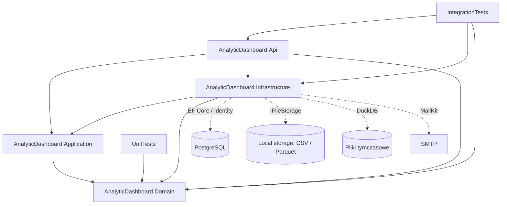

# Audyt backendu Aperture / AnalyticDashboard — architektura

Data: 2026-11-06. Audyt diagnostyczny, bez implementowania poprawek.

## Metoda, zakres i ograniczenia

Rozpoznano całe drzewo `backend/src` i `backend/tests`: 4 projekty produkcyjne, 2 testowe, 204 pliki C# produkcyjne poza migracjami, 33 pliki migracji/snapshotów i 39 plików C# w testach (bez `bin/obj`). Szczegółowo prześledzono wszystkie rodziny endpointów, handlery głównych przepływów, repozytoria, konfiguracje EF, encje, Identity, storage, import, DuckDB i odpowiadające im testy. Kontrakty i małe typy wyników oceniono w kontekście ich wywołań. Migracje oceniono statycznie, ze szczególnym uwzględnieniem zmian datasetów, dashboardów, widgetów i Revision; nie wykonano pełnego odtwarzania historycznych snapshotów ani aktualizacji istniejącej bazy.

Nie analizowano frontendu, środowiska produkcyjnego, reverse proxy, polityk chmurowych, rzeczywistych sekretów, zawartości baz ani plików użytkowników. Nie przeprowadzono pentestu, benchmarków, EXPLAIN ani audytu CVE całego grafu zależności. Brak potwierdzonego ataku w tym raporcie nie stanowi dowodu jego niemożliwości.

Nie zmieniono kodu, testów, konfiguracji, pakietów ani bazy. Raporty są jedynymi celowo utworzonymi plikami. `git status --short` nie zadziałał: Git nie mógł wejść do nadrzędnego katalogu repozytorium w dostępnym środowisku. Nie ma więc niezależnego potwierdzenia stanu zmian przez Git ani identyfikatora commit; lokalizacje odnoszą się do zastanego drzewa plików.

### Weryfikacja wykonawcza

- Uruchomiono istniejącą, wcześniej skompilowaną bibliotekę testów: `dotnet tests/AnalyticDashboard.UnitTests/bin/Debug/net10.0/AnalyticDashboard.UnitTests.dll -noLogo`. Wynik: **19 testów, 0 błędów, 0 niepowodzeń, 0 pominiętych**, około 0,160 s czasu testów, kod wyjścia 0.
- Lista testów zawiera 12 metod: 11 dla Project i 1 dla Widget; dane teorii dają 19 przypadków. DLL z 2026-11-06 00:56:40 jest nowsza od obu plików testowych. Nie wykonano świeżej kompilacji, zatem wynik dotyczy istniejącego artefaktu, a zgodności binariów ze źródłami nie poświadczono nowym buildem.
- Nie uruchomiono testów integracyjnych: `tests/AnalyticDashboard.IntegrationTests/ApiFixture.cs:30-48` uruchamia PostgreSQL i `Database.MigrateAsync`. Także izolowana migracja byłaby sprzeczna z zakazem użytkownika. Nie zmieniano fixture, aby obejść to ograniczenie.
- Odczyt `dotnet --info` wskazał SDK 10.0.303 i runtime 10.0.11; część diagnostyki workloadów zgłosiła odmowę dostępu do Windows Service Control Manager. Uruchomienie samego zestawu jednostkowego powiodło się bez podnoszenia uprawnień.

## Technologie i struktura

Wersje poniżej wynikają z plików projektu, nie z założenia o „najnowszych” pakietach.

| Element | Implementacja / wersja |
|---|---|
| Solution | `AnalyticDashboard.slnx`, projekty `src/` i `tests/` |
| Platforma | wszystkie projekty `net10.0`, Nullable i ImplicitUsings włączone |
| SDK | nadrzędny `../global.json`: 10.0.303, rollForward disabled |
| HTTP | ASP.NET Core Minimal APIs, ręczna rejestracja handlerów |
| Persistence | EF Core / Identity EF 10.0.10, Npgsql i provider EF 10.0.3 |
| Analityka | DuckDB.NET.Data.Full 1.5.5, Parquet / zstd |
| E-mail | MailKit 4.17.0, SMTP |
| Pozostałe | CsvHelper 33.1.0 (nie znaleziono użycia), Pkcs 10.0.13 |
| Dokumentacja API | Swashbuckle 10.2.3, OpenApi 10.0.10; Swagger w Development |
| Testy | xUnit v3 3.2.2, Test SDK 17.14.1, Testcontainers PostgreSql 4.14.0, obraz postgres:16.15; MVC.Testing 10.0.11 |

Różnice patchy pakietów nie są same w sobie zgłoszone jako błąd. Brak connection stringa w wersjonowanym `appsettings.json` jest zgodny z dostarczaniem konfiguracji zewnętrznie; jego brak powoduje czytelny błąd startu w `Infrastructure/DependencyInjection.cs:37-38`. Nie odczytywano user-secrets.

| Projekt / moduł | Faktyczna odpowiedzialność |
|---|---|
| Domain | Project, Dashboard, Widget, Dataset, DatasetVersion, ImportJob; walidacja i zmiany stanu; WidgetLayout jako niemutowalny record |
| Application | przypadki użycia w katalogach funkcjonalnych, command/query/result, porty persistence/storage/Identity/analityki; bez referencji do EF i ASP.NET |
| Infrastructure | AppDbContext, konfiguracje i migracje, repozytoria EF, Identity, SMTP, LocalFileStorage, DuckDB i BackgroundService |
| Api | composition root, cookies/middleware, routing, odczyt ClaimsPrincipal, mapowanie HTTP i DTO, sesja rejestracyjna |
| UnitTests | domena Project i pojedynczy test atomowej walidacji konfiguracji Widget |
| IntegrationTests | rzeczywisty PostgreSQL w kontenerze, WebApplicationFactory, test auth lub prawdziwe cookies, testowy e-mail, ręcznie wywoływany processor |

## Diagram zależności

Strzałki oznaczają referencje projektów, a przerywane — użycie zasobów zewnętrznych.

Kierunek zależności jest zdrowy: Domain nie zależy od infrastruktury, Application definiuje porty, Infrastructure je implementuje. Referencja Api do Infrastructure jest uzasadniona composition rootem. API używa ApplicationUser/AppDbContext przy konfiguracji Identity, a nie do wykonywania zapytań biznesowych w endpointach. Nie ma potrzeby wprowadzania mediatora, generic repository ani kolejnej warstwy tylko dla symetrii.

## Najważniejsze przepływy

### HTTP i uprawnienia

`Program.cs` konfiguruje Identity, cookies, authorization, ProblemDetails, handlery i middleware. Grupom projektów/datasetów/dashboardów/widgetów nadano RequireAuthorization. Endpoint wyciąga poprawny niepusty Guid użytkownika przez `ClaimsPrincipalExtensions`, a repozytoria filtrują jednocześnie resource ID, project ID i OwnerId projektu. Odpowiedź 404 ukrywa istnienie cudzych zasobów. Nie znaleziono potwierdzonego IDOR w prześledzonych ścieżkach.

Filtry własności są w konkretnych metodach repozytoriów, nie w globalnym filtrze EF. Jest to czytelne w skali projektu, ale nowa metoda musi konsekwentnie zachować scope. Pracownik importów operuje wewnętrznie na identyfikatorach bez kontekstu użytkownika; nie jest to samo w sobie luka.

### Project CRUD

Endpoint → handler → IProjectRepository → PostgreSQL. Create normalizuje encję i zapisuje ją jednym SaveChanges. Unikalność `(OwnerId, Name)` opiera się na citext i indeksie bazy, a konflikt konkretnego constraintu mapowany jest na wynik aplikacyjny. Rename/Delete używają warunkowego ExecuteUpdate/Delete, więc nie opierają poprawności na osobnym wcześniejszym odczycie. Read list ma limit pageSize, Count, stabilne sortowanie CreatedAtUtc/Id i indeks odpowiadający filtrowaniu/sortowaniu. Count i strona nie są jednym snapshotem; niewielka niespójność metadanych przy zmianach równoległych jest obecnym kompromisem, nie wykazaną utratą danych.

### Zapis całego zestawu widgetów i Revision

`UpdateDashboardWidgetsHandler.cs:35-53` ładuje śledzony dashboard i sprawdza ExpectedRevision. Następnie sprawdza unikalność ID, kolizje, dostępność datasetów oraz konfigurację. Porównuje istniejące i przesłane ID: brakujące tworzy, obecne aktualizuje, pominięte usuwa. Pusta lista oznacza usunięcie wszystkich widgetów — to semantyka synchronizacji całego zestawu.

`DashboardConfiguration.cs:32-34` ustawia Revision jako token concurrency, `Dashboard.cs:59-61` podnosi go z checked arithmetic. Handler stage'uje zmiany i wykonuje **jeden** IUnitOfWork.SaveChanges (`:158-199`). Wspólny scoped AppDbContext zapewnia transakcyjny zapis zmian do PostgreSQL. Konflikt EF mapowany jest przez `AppDbContext.cs:45-54` na OptimisticConcurrencyException. Handler odczytuje świeżą projekcję revision i zwraca 409 lub 404, jeśli dashboard został usunięty (`:201-218`). Sama wstępna kontrola revision nie jest jedyną ochroną — token w UPDATE chroni też przed wyścigiem po odczycie.

Nie potwierdzono lost update w tym mechanizmie. Pozostają problemy brzegowe: globalne ID nowych widgetów, zniknięcie datasetu po walidacji, koszt listy kolizji i brak deterministycznego testu całej gałęzi obsługi konfliktu HTTP. GET dashboardu/revision i GET widgetów są oddzielne; jeżeli klient potrzebuje spójnego snapshotu obu, należy najpierw sprawdzić jego kolejność pobierania. Nie jest to potwierdzony błąd bez frontendu.

### Import CSV → gotowa wersja

1. Autoryzowany multipart endpoint otwiera strumień; handler sprawdza projekt, nazwę i rozszerzenie.
2. Handler tworzy Dataset, Pending DatasetVersion i Pending ImportJob, zapisuje CSV pod kluczem z GUID, a następnie `PendingDatasetImportRepository` zapisuje trzy rekordy jednym SaveChanges. Przy błędzie próbuje sprzątnąć źródło.
3. BackgroundService wykonuje recovery raz na starcie, potem pobiera Pending w nowym scope dla każdej iteracji.
4. Processor zapisuje Running, importer kopiuje CSV do temp, tworzy tabelę DuckDB, oblicza metadane, eksportuje Parquet z zstd i zapisuje wynik do storage.
5. Processor zmienia wersję na Ready, publikuje ją jako CurrentVersionId i oznacza job Completed **w jednym SaveChanges**. Typowe błędy importera oznaczają Failed. Pliki temp są sprzątane w finally.

Atomowość SQL nie obejmuje filesystemu. Szczególnie ważne są kolejność kasowania plików, trwałość informacji o cleanup, niejednoznaczny wynik commit oraz recovery. Nie należy opisywać całego przepływu jako „brak transakcji”: transakcje SQL są, ale granica DB–plik wymaga osobnego projektu niezawodności.

### Analityka i profilowanie

Handler sprawdza własność datasetu i jego bieżącą Ready wersję → czytnik DuckDB → DuckDbParquetExecutor kopiuje cały Parquet do temp i otwiera nową instancję in-memory. Nazwy kolumn zapytania są porównywane ze schematem, escapowane jako identyfikatory; ścieżki i wartości limit/offset są parametrami. Agregacje pochodzą z zamkniętego switcha.

Wiersze mają paginację; agregacje zwracają wszystkie grupy. Profil wykonuje zapytania dla kolejnych kolumn i pobiera 10 wierszy preview. Wiele widgetów tego samego datasetu nie współdzieli odczytu pliku ani wyniku. Nie stwierdzono typowego EF N+1 w listowaniu datasetów: bieżące wersje są pobierane zbiorczo (`GetDatasetsHandler.cs:49-58`).

### Identity i e-mail

Rejestracja korzysta z UserManager, unikalnych indeksów i potwierdzania e-mail. API przechowuje czasową, chronioną Data Protection sesję rejestracyjną (30 min, HttpOnly, Secure, SameSite Lax, Path /auth), następnie może wystawić cookie po potwierdzeniu. Reset/potwierdzanie używają providerów tokenów Identity i obsługują wybrane konflikty współbieżności. Security stamp jest sprawdzany bez odstępu (`Program.cs:84-87`), co wspiera natychmiastowe odwołanie sesji po resecie/usunięciu konta kosztem dodatkowych zapytań do bazy.

Logowanie hasłem omija część standardowego pipeline'u SignInManager — to istotne znalezisko, a nie argument za przepisaniem całego auth. Obsługa wysyłki używa SMTP; publiczne odpowiedzi forgot/resend są celowo ogólne. Błędy dostawy bywają całkowicie wyciszane operacyjnie.

## Mocne strony

- Niewielka, zrozumiała architektura i jawne DI. Brak frameworka CQRS nie utrudnia odtworzenia przepływów.
- Izolacja właścicieli w predykatach bazy, z testami cudzych zasobów; brak polegania wyłącznie na RequireAuthorization.
- Project ma spójne normalizowanie Unicode, constraints i unikalność wymuszaną przez PostgreSQL, także dla wyścigów.
- Zapis widgetów obejmuje walidację przed mutacją, synchronizację całego zestawu, atomowy SaveChanges i rzeczywisty token concurrency.
- Read-only zapytania zwykle mają AsNoTracking, listy deterministyczne sortowanie, podstawowe FK i indeksy są obecne.
- SQL DuckDB nie jest dowolnym SQL klienta; weryfikacja schematu, cytowanie identyfikatorów i parametry zmniejszają powierzchnię ataku.
- Klucze storage są generowane z GUID, resolver odrzuca rooted paths i wyjście poza root. Nie znaleziono ścieżki HTTP pozwalającej podać dowolny storageKey.
- CancellationToken jest przekazywany przez endpointy, handlery, EF, kopiowanie i wywołania DuckDB. Skuteczności przerwania natywnej pracy DuckDB nie zmierzono; wrapper async nie jest dowodem takiego przerwania. API UserManager nie udostępnia tokena we wszystkich używanych metodach — nie jest to automatycznie błąd projektu.
- Testy integracyjne korzystają z prawdziwego PostgreSQL, weryfikują stan rekordów i rollback, a część auth używa rzeczywistych cookies zamiast wyłącznie atrap.
- Ogólny exception handler i bezpieczna odpowiedź statusu importu nie ujawniają surowego ErrorMessage joba w API.

## Ocena jakości i prostoty

Rozdrobnienie command/query/result według przypadków użycia jest proporcjonalne do projektu. Klasy o jednej prostej odpowiedzialności i podobne mapowania DTO nie są automatycznie problemem. Nie zaleca się ich masowego scalania ani tworzenia wspólnego „generycznego” CRUD.

Prawdziwym kosztem utrzymania są niewywoływane metody persistence oraz martwy typ/pakiet opisane w AUD-020. Różne modele wyników (nullable/bool w dashboardach, jawne rezultaty w projektach/datasetach) zwiększają prawdopodobieństwo pominięcia mapowania błędów; konkretnym skutkiem jest AUD-012, a nie sam brak symetrii typów.

`Widget.ValidateConfiguration` ponownie normalizuje dane przy rzeczywistej mutacji; może to tworzyć dodatkowe operacje na stringach, ale przy rozsądnie ograniczonej liczbie widgetów nie ma podstaw do osobnego refaktoru optymalizacyjnego. Organizację using/formatowanie warto porządkować lokalnie przy zmianach; nie znaleziono powodu do etapu przebudowy całego projektu wyłącznie dla stylu C#.

## Obszary do pogłębienia

1. Cykl życia danych między PostgreSQL i plikami: delete, import, awarie zapisu, anulowanie, restart, retencja i cleanup.
2. Granice bezpieczeństwa wdrożenia: lockout/rate limiting, CSRF dla cookies/uploadu, TLS SMTP, Data Protection, wspólny storage i liczba workerów.
3. Analityka na reprezentatywnych danych: ilość kopiowanego Parquet, kardynalność grup, profil szerokich datasetów, liczba widgetów, precyzja i wartości niefinitywne liczb. `DuckDbDatasetQueryReader.cs:156-185` jawnie konwertuje agregaty na double; utrata dokładności dużych integer/decimal jest kompromisem wymagającym ustalenia oczekiwanej precyzji biznesowej, nie dowodem błędu dla wszystkich wykresów.

Szczegółowe problemy: [02-findings.md](02-findings.md). Etapy bezpiecznych zmian i macierz testów: [03-refactoring-roadmap.md](03-refactoring-roadmap.md).
