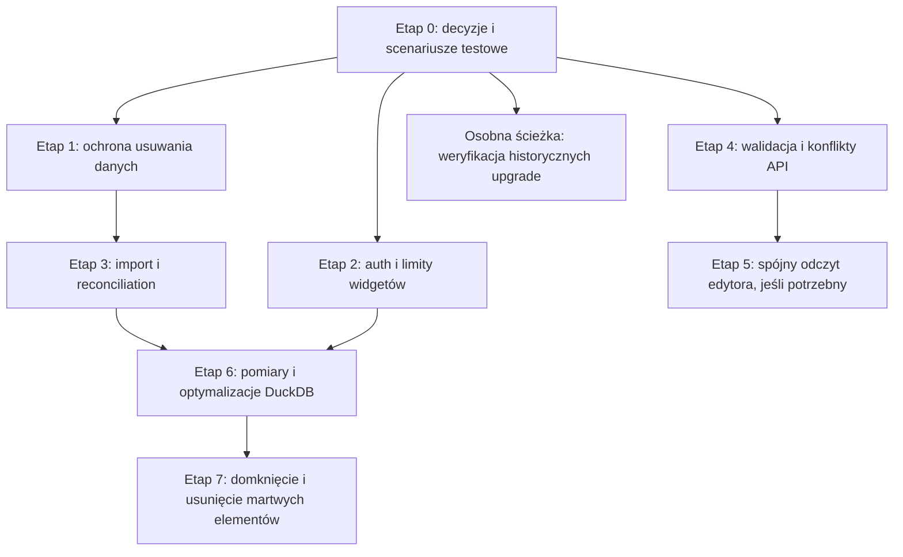

# Audyt backendu — plan bezpiecznego refaktoru

Data: 2026-11-06. Dokument proponuje prace następcze. **Żadnego etapu nie zaimplementowano w ramach audytu.** ID odnoszą się do [02-findings.md](02-findings.md).

## Zasada prowadząca

Backend ma wystarczająco dobrą strukturę, aby poprawiać go małymi zmianami. Najpierw zabezpieczyć dane i istotne granice bezpieczeństwa, potem niezawodność importu i kontrakty, następnie mierzone koszty analityki. Nie zaczynać od przebudowy solution, mediatorów, generic repository ani rozbudowanej domeny agregatów.

Każdy etap powinien być osobnym małym PR lub kilkoma PR-ami z jednym skutkiem biznesowym. Zmiany schematu, storage i odpowiedzi HTTP powinny mieć jawny plan wdrożenia oraz przegląd konsumenta. Nie zachowywać martwych API wyłącznie dla hipotetycznej kompatybilności.

## Grupy problemów i zależności

| Grupa | ID | Cel | Zależność |
|---|---|---|---|
| Ochrona danych | 001, 006, 008 | plik nie znika, gdy metadane nadal go wskazują; usunięte dane są finalnie sprzątane | decyzja o delete/retencji i obsłudze nieznanego commit |
| Niezawodny import | 004, 007, 008 | jeden właściciel zadania; brak wiecznego Running; bezpieczne recovery | liczba workerów, trwałość storage; wspólny plan z cleanup |
| Bezpieczeństwo | 002, 018, 023 | egzekwowane blokady/limity, właściwy TLS, świadoma ochrona cookie upload | topologia hostów i SMTP; nie czeka na refaktor analityki |
| Walidacja i kontrakt zapisu | 012–016, 022, 024 | przewidywalne 400/404/409, wersja odpowiada odczytanemu stanowi | testy brzegowe; klient dla 022 i semantyki WidgetId |
| Budżety zasobów | 003, 009–011, 021 | praca ograniczona przez limity i rzeczywistą skalę | limit produktu i pomiary; limit widgetów wdrażać wcześnie |
| Obserwowalność | 017 | awarie dostawy widoczne bez ujawniania danych | niezależna mała zmiana |
| Testy i uproszczenie | 019, 020 | testy dowodzą wymaganych zachowań; mniej martwego kodu | dołączać do etapów, nie wielomiesięczny osobny program |
| Upgrade danych | 005 | znana i bezpieczna ścieżka aktualizacji | historia faktycznych wdrożeń; bez niej nie zmieniać dawnych migracji |

Strzałki nie oznaczają konieczności ukończenia całego auth przed poprawieniem walidacji. Poszczególne małe poprawki można prowadzić niezależnie; cleanup i publication należy projektować wspólnie.

## Etap 0 — ustalić wymagania i zabezpieczyć najważniejsze zachowania

**Zakres:** AUD-001/004/005/006/019/022/023 oraz kontrakty produktu.

Decyzje konieczne przed zależnymi zmianami:

1. Czy dataset używany przez widgety ma być niemożliwy do usunięcia, czy usunięcie ma usuwać/przepinać widgety? Najprostsza spójna polityka na dziś to przewidywalny konflikt i zachowanie plików, jeśli odpowiada UX.
2. Jak długo przechowujemy źródłowy CSV i czy istnieje gwarancja fizycznego usunięcia po DELETE? Co ma się stać z Running przy usunięciu datasetu/projektu?
3. Czy deployment ma jedną instancję API/workera, czy może wykonywać rolling restart z nakładaniem instancji? Gdzie są współdzielone pliki i klucze Data Protection, jak wykonywany jest backup?
4. Jaka jest sensowna maksymalna liczba widgetów, punktów wykresu, rozmiar i szerokość pliku oraz równoległość importu/query? Nie zmieniać limitów na arbitralne wartości bez sprawdzenia realnych dashboardów.
5. Czy wspieramy istniejące instalacje sprzed migracji dataset versions / refactor dashboard? Czy tamte bazy zawierały dane wymagające zachowania?
6. Jak frontend łączy Revision i listę widgetów? Czy generuje/reużywa WidgetId podczas kopiowania/retry? Jakie originy mogą wysyłać cookie-auth upload?

Pierwsze testy do przygotowania w przyszłych pracach: dataset Ready z plikiem i widgetem; współbieżny save po odczycie tej samej revision; kontrolowana awaria finalnego zapisu importu; konto z aktywną blokadą. Nie potrzeba rozbudowanego frameworka testowego — wystarczą kontrolowane fake/dekoratory portów, dwa scope i sygnalizacja kolejności zamiast opóźnień.

**Kryterium zakończenia:** krótka tabela przyjętych decyzji, ustalone niezmienniki i scenariusze, które pokazują obecne błędy. Wykonanie testów integracyjnych z aktualnym fixture wymaga pracy dopuszczającej migracje; podczas tego audytu ich nie uruchamiano.

## Etap 1 — zatrzymać utratę plików przy DELETE

**Zakres:** AUD-001 i pierwsza część AUD-006. Priorytet przed szerokim refaktorem.

Małe, logiczne kroki:

1. Wprowadzić jednoznaczny wynik „dataset używany” i mapowanie na uzgodniony konflikt, zachowując constraint jako ostateczną ochronę wyścigu.
2. Zmienić kolejność tak, aby odrzucony SQL nigdy nie usuwał pliku nadal istniejącego zasobu.
3. Zapewnić trwałą informację o plikach do cleanup po skutecznym usunięciu. Sam zapis listy do pamięci po commit może zostać utracony przy crash; dobrać najmniejszy trwały mechanizm do wymagań. Nie jest potrzebna rozproszona transakcja filesystem–PostgreSQL.
4. Rozszerzyć tę samą politykę o źródła CSV i usunięcie projektu. Uwzględnić import Pending/Running przed wykonaniem masowego cleanup.

**Weryfikacja po etapie:** referenced DELETE zwraca uzgodniony konflikt i zachowuje Parquet/CSV oraz stan DB; błąd SQL/anulowanie nie niszczy dostępnego datasetu; poprawne usunięcie powoduje finalne usunięcie wszystkich właściwych plików; awaria cleanup jest widoczna i ponawialna; żaden cudzy zasób nie jest usuwany. Powtórzenie cleanup jest bezpieczne.

**Ryzyko:** nie zastępować jednej utraty danych nową kaskadą widgetów bez decyzji produktu; nie uznawać pre-check za zamknięcie wyścigu.

## Etap 2 — przywrócić ochrony Identity i ograniczyć koszt żądań

**Zakres:** AUD-002, AUD-003. Może być prowadzony niezależnie od zmian storage.

1. Użyć standardowej weryfikacji hasła i blokady Identity, utrzymując wymaganie confirmed email oraz istniejący RememberMe.
2. Dodać uzgodnione limity auth, obejmujące kosztowne logowanie/rejestrację i wysyłki. Limity w wielu instancjach muszą odpowiadać deploymentowi; nie dodawać zewnętrznego magazynu tylko dla potencjalnej skali.
3. Wprowadzić limit widgetów przed alokacją całej listy zmian i w handlerze. Wykrywanie kolizji kończyć na pierwszej albo ograniczonej liczbie błędów.

**Weryfikacja po etapie:** zablokowane konto nie uzyskuje cookie; próby/odblokowanie/liczniki działają; niepotwierdzone konto nadal nie loguje się; brak regresji resetu hasła i revocation. Nadmierna lista widgetów jest odrzucana tanio przed pracą O(n²); istniejące poprawne layouty, pusta lista, styk krawędzi i duże współrzędne zachowują semantykę.

**Ryzyko:** limitowanie nie może ułatwiać trwałej blokady wybranej ofiary; błędne rozpoznanie IP za proxy może ograniczyć wszystkich użytkowników naraz.

## Etap 3 — domknąć state machine importu i recovery

**Zakres:** AUD-004/007/008 i pozostała część AUD-006.

Rozdzielić zmiany na małe PR-y:

1. Zapisać i wyegzekwować przyjęty model pojedynczego workera albo dodać atomowe przejęcie. Nie łączyć zmiany z zamianą PostgreSQL na zewnętrzny broker bez osobnego uzasadnienia.
2. Dla wielu workerów recovery powinno rozpoznawać właściciela i wygaśnięcie przejęcia; aktywne Running nie jest automatycznie przerwanym zadaniem.
3. Oddzielić własność artefaktu od docelowego klucza publikacji. Nieudana próba nie może usuwać pliku innej skutecznej próby.
4. Obsłużyć błąd finalnego zapisu i nieznany wynik commit. Zapewnić okresową lub celowaną rekoncyliację porzuconej pracy zamiast wymagać restartu całego API.
5. Połączyć cleanup źródeł/wyników z ustaloną retencją; rozróżnić normalny błąd formatu, awarię infrastruktury, anulowanie hosta i usunięcie zasobu podczas pracy.

**Weryfikacja po etapie:** ten sam Pending ma co najwyżej jednego aktywnego właściciela; rolling restart nie niszczy aktywnego wyniku; błąd przed commit, nieznane potwierdzenie commit i błąd cleanup prowadzą do zrozumiałego końcowego stanu; żaden Ready nie wskazuje brakującego pliku; porzucone zadanie nie pozostaje Running bez możliwości obsługi; praca na usuniętym dataspecie nie publikuje orphanów bez śladu.

**Ryzyko:** to najbardziej sprzężony etap — zmienia publikację, kolejkę i cleanup. Utrzymać pojedynczą granicę SaveChanges dla Ready + CurrentVersionId + Completed, która już jest mocną stroną.

## Etap 4 — przewidywalna walidacja i błędy zapisu

**Zakres:** AUD-012/013/014/015/016/024; AUD-017 jako niezależny quick win.

1. Naprawić walidację nazwy dashboardu, długości uploadu i wartości enum bez zmiany struktury solution.
2. Określić semantykę konfliktu WidgetId; tłumaczyć konkretne PK/FK zamiast globalnie chować DbUpdateException. Predykaty owner/project pozostają obowiązkowe.
3. Obsłużyć zniknięcie projektu/datasetu między walidacją a zapisem. Zabezpieczenie DB ma pozostać, a HTTP ma odzwierciedlać przewidywalny konflikt/brak zasobu.
4. Zweryfikować i ograniczyć długości e-maila oraz postaci normalizowanej według schema Identity.
5. Dodać sygnał awarii SMTP bez zmiany ogólnej publicznej odpowiedzi forgot/resend.

**Weryfikacja po etapie:** błędne payloady dają przewidywalne 400, konflikt wersji 409, cudzy zasób nie ujawnia istnienia; zniknięcie zależności nie daje 500 ani częściowego zapisu. Odrzucone żądanie nie pozostawia nowych plików/rekordów; operacyjne logi nie zawierają tokenów ani haseł.

**Ryzyko:** globalny catch ArgumentException/DbUpdateException mógłby ukryć prawdziwe błędy programistyczne. Zmiany powinny dotyczyć znanych, rozpoznawanych przypadków.

## Etap 5 — kontrakt edytora i testy rzeczywistego konfliktu

**Zakres:** AUD-019/022. Najpierw sprawdzić frontend; jeśli odczyt jest już bezpiecznie uporządkowany, AUD-022 może zakończyć się dokumentacją kontraktu i testem klienta.

Jeżeli potrzebny jest wspólny snapshot, dodać najprostszy odczyt revision + widgets. Zapewnić rzeczywistą spójność danych, nie tylko umieścić dwa niezależne SELECT w jednym handlerze. Po migracji realnych użyć można usunąć zbędny wariant odczytu; nie utrzymywać duplikatów API bez konsumenta.

Dodać deterministyczny test przegranej po zapisie do bazy przez drugi scope oraz usunięcia dashboardu po odczycie. Zachować istniejące testy UnitOfWork i snapshoty widgetów. Dla dwóch requestów tworzących ten sam nowy WidgetId sprawdzić wynik rzeczywistej kolejności SQL, zanim uzna się go za obsłużony samym tokenem dashboardu.

**Weryfikacja po etapie:** odczyt zwraca revision odpowiadającą dokładnie temu zestawowi; stary stan nie jest podpisywany nowszą revision; handler rzeczywiście wykonuje gałąź catch i zwraca 404/409; przegrany zapis nie zatwierdza create/update/delete ani revision.

## Etap 6 — pomiary i celowane ograniczenie kosztu analityki

**Zakres:** AUD-009/010/011/021.

Najpierw przygotować reprezentatywne dane: mały plik używany dziś, większy wąski plik, szeroki plik, kolumna z dużą liczbą grup, kilka/kilkadziesiąt widgetów jednej wersji. Zmierzyć czas, przyrost pamięci, bajty temp I/O, liczbę komend i zachowanie równoległych żądań. Ustalić budżet akceptacji przed zmianą; raport nie zawiera wymyślonego benchmarku.

Kolejne, osobne optymalizacje:

1. Limit wyników grupowania z jawną semantyką dla klienta. Sprawdzić także koszt obliczenia, nie tylko rozmiar JSON.
2. Ograniczenie kopiowania niezmiennego lokalnego Parquet przy odczytach. Chronić lifetime względem DELETE i nie ujawniać ścieżek w kontraktach Application.
3. Cache profilu po ID wersji lub wcześniejsze obliczanie; nie cache'ować tylko po ID datasetu, którego bieżąca wersja może się zmienić.
4. Łączenie agregacji profilu dopiero gdy pomiary potwierdzą istotny koszt. Sprawdzić null/date/numeric i precyzję.
5. Paginacja list zasobów, jeśli liczba datasetów/dashboardów tego wymaga; nie tworzyć nowego modelu read store dla prostych list.

**Weryfikacja po etapie:** poprawne wyniki wszystkich agregacji, stabilny kontrakt limitu, spadek zmierzonego I/O/pracy przy tej samej odpowiedzi, brak narastania temp, izolacja wersji i właścicieli oraz kontrolowany wpływ anulowania. Wyniki pomiarów porównać przed/po dla tego samego środowiska.

**Ryzyko:** cache bez ograniczeń może zamienić koszt I/O w wyciek pamięci/dysku; „optymalizacja” zmieniająca dokładność lub pomijająca grupy bez jawnego kontraktu nie spełnia kryterium.

## Etap 7 — uproszczenie i domknięcie wdrożenia

**Zakres:** AUD-018/020/023, konfiguracja oraz rekomendacje o niższym wpływie.

- Usunąć potwierdzone martwe elementy po sprawdzeniu konsumentów poza backendem. Powtórzyć wyszukiwanie odwołań, ponieważ wcześniejsze etapy mogą zmienić użycia.
- Ustalić jawny tryb SMTP i walidację konfiguracji; nie włączać TLS do lokalnego narzędzia developerskiego bez potrzeby.
- Sprawdzić CSRF w rzeczywistej topologii originów i dodać ochronę zgodną z klientem.
- Udokumentować root/trwałość storage, backup, liczbę workerów i klucze Data Protection. Nie zmieniać interwału security stamp bez decyzji o revocation.
- Poprawiać using/nazewnictwo i lokalne mapowania przy dotykanych plikach. Nie mieszać masowego formatowania z naprawami integrity.

**Weryfikacja po etapie:** świeży build i właściwy zestaw testów w przyszłej sesji; brak nieużywanych zależności wymienionych w AUD-020; poprawne cookie/upload/SMTP na docelowym środowisku; udokumentowane odzyskanie po restarcie. Nie wymaga się nowych testów jednostkowych tylko po to, by sprawdzić usunięcie nieużywanego recordu.

## Osobna ścieżka — aktualizacja baz historycznych

AUD-005 ma wysoki potencjalny skutek, ale najpierw wymaga ustalenia, czy historyczna instalacja z danymi jest wspierana. Po potwierdzeniu przygotować bezpieczną kopię reprezentatywnej bazy, inwentarz plików i oczekiwane mapowanie starych kolumn/ID. Dopiero w osobno autoryzowanej pracy zweryfikować migrację na kopii. Nie uznawać testu migracji pustej bazy za dowód zachowania danych. Nie poprawiać opublikowanej historii na ślepo i nie używać produkcji jako środowiska diagnostycznego.

**Kryterium:** znana wspierana ścieżka upgrade, zachowane relacje i metadane plików, plan odzyskania przy błędzie, zgodność docelowego schema z modelem. Jeśli dotyczy wyłącznie pustej bazy developerskiej, ryzyko należy zamknąć udokumentowaną decyzją zamiast rozbudowywać niepotrzebny migrator.

## Quick wins

| Zmiana | ID | Dlaczego mała | Warunek |
|---|---|---|---|
| Enum.IsDefined przed query | 013 | lokalna walidacja, istnieje analogia w endpointach widgetów | test nieznanej liczby i wszystkich wspieranych enumów |
| Wynik InvalidName przy create dashboard | 012 | użycie istniejącej reguły domeny | testy blank i Unicode |
| Limit widgetów + przerwanie kolizji | 003 | usuwa zbędną pracę bez nowej struktury danych | uzgodniony limit |
| Limity nazwy pliku/datasetu | 014 | wspólne stałe i wczesne odrzucenie | zgodność liczenia znaków z DB |
| Bezpieczny sygnał awarii SMTP | 017 | nie zmienia kontraktu publicznego | redakcja danych w logach |
| Usunięcie martwych metod/typu/pakietu | 020 | mniej kodu, brak zastępczej abstrakcji | potwierdzone rzeczywiste użycia także poza solution |

Naprawa AUD-001 jest pilniejsza od większości quick wins mimo większego wysiłku. Nie odkładać jej do momentu uporządkowania stylu całego projektu.

## Macierz testów i obecnych luk

| Obszar | Co już daje wartość | Brakujące scenariusze / cel |
|---|---|---|
| Project domain / DB | Unicode, whitespace, nazwy graniczne, unikalność per owner, constraints | utrzymać podczas zmian, nie dublować kontraktów testami każdej linii |
| Project HTTP | izolacja, walidacja, paginacja/sortowanie, równoległe create/rename/delete | sprawdzić konsekwencje delete projektu z realnym importem/plikami |
| Dashboard HTTP | dedykowany GET sprawdza cudzy projekt | create positive/blank/null/long, delete, kontrakt revision, project deletion race |
| Synchronizacja widgetów | zapis config/layout, create/update/delete, duplicate ID, brak zmian po odrzuceniu, stale revision, rollback dwóch kontekstów | deterministyczny handler catch, dashboard deletion, dataset deletion po walidacji, globalny WidgetId, limity, ten sam nowy ID w dwóch zapisach |
| Odczyt edytora | osobne get dashboard/widgets | spójność revision ze stanem, zależnie od realnego klienta |
| Izolacja zasobów | wiele testów właściciela/cudzego projektu | tabela owner × project × dashboard × dataset × widget także dla rows/query/profile/data/delete; potwierdzić 401 na każdym nowym endpointcie |
| Dataset DELETE | usuwa rekord bez wersji i odmawia obcemu ownerowi | Ready z plikiem, referenced dataset, wszystkie źródła/wyniki, FK failure, partial cleanup, anulowanie, Running race |
| Import | poprawny upload, cudzy projekt przed obsługą pliku, konwersja CSV, processor sukces i brak źródła, recovery pojedynczego Running | długości nazw, błędny CSV, I/O denial/disk-full przez kontrolowany stub, final-save failure, ambiguous commit, cleanup failure, dwa workery, rolling restart, anulowanie i usuwanie w trakcie |
| Profil i rows | happy path profilu z małego pliku | rows: brak dedykowanego zestawu; pageSize/page bounds, empty data, kolejność, Unicode/null/date, missing artifact, cancellation; profil szeroki i cache nowej wersji |
| Agregacja / widget data | Sum i poprawne dane widgetu | Average/Min/Max/Count, nullable measure, grupa null, zła/nietypowa cytowana kolumna, tekst zamiast number, niezdefiniowany enum, duża kardynalność, duże decimal/integer, NaN/Infinity i serializacja |
| Identity | real cookies, RememberMe, confirmed email, reset/reuse/concurrency, revocation po resecie/usunięciu usera | LockoutEnd, AccessFailedCount, próg i odblokowanie, rate limits, limit email i normalizacji |
| SMTP | testowa awaria dostawy zachowuje publiczny sukces | sygnał operacyjny, tryb TLS i config validation, bez tokenów w logach |
| Upload / browser | autoryzacja właściciela po stronie API | prawdziwe originy, cookie SameSite, antiforgery/Origin, efektywny limit uploadu |
| Upgrade | fixture tworzy nową bazę migracjami | historyczny schema z rzeczywistymi relacjami i plikami; tylko w osobno dopuszczonym środowisku |

Nie wszystkie wiersze uzasadniają od razu rozbudowane E2E. Reguły domeny i walidację można testować szybko lokalnie; ograniczenia PostgreSQL, transakcje i konflikty muszą mieć testy z rzeczywistym providerem; CSRF wymaga zachowania przeglądarki, a nie samego HttpClient.

### Potencjalne fałszywe poczucie bezpieczeństwa

- Task.WhenAll nie wymusza przeplatania odczyt/zapis. Przy testach race używać sygnałów/barier w konkretnym punkcie przepływu i osobnych scope.
- Poprawny status HTTP bez sprawdzenia rekordów i plików nie dowodzi poprawności operacji wieloetapowej. Istniejące snapshoty widgetów są dobrym wzorem weryfikacji zachowania.
- TestAuthHandler jest dobry do macierzy właścicieli, ale omija rzeczywiste cookies, security stamp i lockout. Zachować testy real auth.
- Testy importu wywołują processor bez normalnie działającego hosted workera (`CustomWebApplicationFactory.cs:29-32` wyłącza worker). Nie dowodzą poprawności pollingu, recovery na starcie ani pracy wielu instancji.
- Sukces migracji na pustym kontenerze nie dowodzi zachowania historycznych danych.

## Kryterium gotowości do długiego refaktoru

Najpierw zamknąć potwierdzoną utratę plików, przywrócić egzekwowanie blokad auth i ograniczyć pracę kolizji. Następnie mieć jawnie przyjęty model workerów oraz powtarzalne testy krytycznych awarii i konfliktów. Dopiero na tej bazie warto przebudowywać poszczególne przepływy. Celem jest mniej niejawnych stanów i mniej kodu utrzymaniowego, a nie większa liczba warstw.

Wynik bieżącej weryfikacji pozostaje ograniczony: 19/19 istniejących skompilowanych testów jednostkowych; integracje, nowy build, migracje i pomiary nie były wykonywane. Szczegóły i granice zakresu: [01-architecture.md](01-architecture.md).

