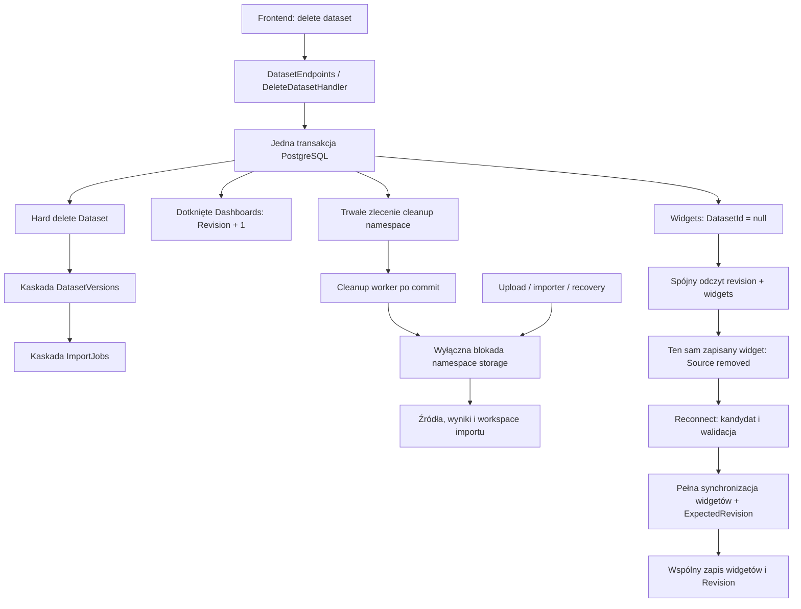

# Aperture — AUD-001: analiza wpływu i projekt implementacji

Data: 2026-11-10. **Projekt zmiany, bez implementacji.** Jedyny nowy plik tej pracy. Ścieżki zaczynające się od `src/` i `tests/` dotyczą backendu; `frontend/` oznacza sąsiedni katalog `../frontend/`.

## 1. Rekomendacja i granice przedsięwzięcia

Rekomendowany model to **trwały Widget z `DatasetId: Guid?`**. `null` oznacza brak podłączonego źródła, a nie draft. Odłączenie zmienia wyłącznie to pole; identyfikator, dashboard, typ, tytuł, layout, czas utworzenia i konfiguracja analityczna pozostają. Tworzenie nadal wymaga źródła. Ponowne podłączenie wymaga walidacji istniejącego, dostępnego datasetu i jego schematu.

DELETE datasetu ma w jednej transakcji PostgreSQL odłączyć aktualne referencje, zwiększyć Revision każdego faktycznie zmienionego dashboardu raz, zapisać trwałe zlecenie cleanup i fizycznie usunąć metadane datasetu. Pliki usuwa osobny, ponawialny worker **po commit**. Przy aktywnym imporcie sam zapis zlecenia nie wystarcza: fizyczny writer i cleanup muszą mieć wspólną blokadę namespace storage, a writer po jej uzyskaniu ponownie sprawdza stan w bazie. W przeciwnym razie importer może odtworzyć plik już po zakończonym cleanup.

To jest najmniejszy rekomendowany wariant **obsługujący również usunięcie podczas importu** dla obecnego LocalFileStorage. Nie dodaje brokera, soft delete datasetu ani systemu draftów backendowych. Koszt jest większy niż samo nullable + kolejka kluczy, ponieważ wymagania obejmują również crash, nieznany commit i późne zapisy importera. Alternatywę „409 podczas importu” i warunki jej bezpieczeństwa opisano w sekcji 12; nie przyjęto jej milcząco.

Przeczytano istniejące raporty 01–07, szczególnie AUD-001/006/008/019/022/028, i sprawdzono aktualne ścieżki backendu oraz rzeczywisty frontend. Wcześniejsza sugestia odmowy usuwania używanego datasetu jest tutaj **zastąpiona zatwierdzoną decyzją o hard delete z zachowaniem widgetów**. Pozostałych raportów ani ich ID nie zmieniono. Nie jest to kolejny audyt całego projektu.

**Poziom dowodu:** opis istniejącego kodu wynika z odczytów źródeł. Protokół docelowy jest projektem opartym na udokumentowanych gwarancjach; nie wykonano eksperymentów blokad, testów, buildów, migracji ani operacji na bazie/storage. Szczególnie translacja zapytań blokujących przez Npgsql/EF oraz wyłączność blokady filesystemu wymagają testów implementacji przed wdrożeniem.

## 2. Mapa zależności i dowody istniejącego zachowania

| Miejsce | Co jest teraz i dlaczego należy je uwzględnić |
|---|---|
| `src/AnalyticDashboard.Domain/Entities/Widget.cs:12,34-71,90-123,178-193` | DatasetId jest wymaganym Guid, konstruktor i UpdateConfiguration wymagają źródła; walidacja sprawdza stringi/enumy, nie schemat danych. |
| `src/AnalyticDashboard.Infrastructure/Data/Configurations/WidgetConfiguration.cs:18-19,55-67` | Wymagany DatasetId, FK dataset Restrict, FK dashboard Cascade; indeksy obu relacji. |
| `src/AnalyticDashboard.Application/Datasets/DeleteDataset/DeleteDatasetHandler.cs:39-64` | Kasowanie plików przed DELETE SQL — mechanizm utraty pliku z AUD-001. |
| `src/AnalyticDashboard.Infrastructure/Repositories/DatasetRepository.cs:66-83` | Samodzielne ExecuteDelete; nie obejmuje wcześniejszego I/O i operacji na widgetach. |
| `src/AnalyticDashboard.Infrastructure/Repositories/ProjectRepository.cs:92-105` | DELETE projektu jest obecnie samym SQL; bez zlecenia cleanup jego kaskada zgubi metadane źródeł/plików. |
| `src/AnalyticDashboard.Infrastructure/Data/Configurations/DatasetConfiguration.cs:29-39`; `DatasetVersionConfiguration.cs:42-46`; `ImportJobConfiguration.cs:43-47` w tym samym katalogu | Project → Dataset → Version → Job kaskaduje. Dataset.CurrentVersionId wskazuje Version z NoAction; nie wolno projektować osobnego, przedwczesnego usuwania wersji. |
| `src/AnalyticDashboard.Application/Widgets/UpdateDashboardWidgets/UpdateDashboardWidgetsHandler.cs:35-53,85-156,158-218` | PUT synchronizuje cały zestaw: nowe ID tworzy, obecne zmienia, pominięte usuwa. Aktualna walidacja datasetów poprzedza klasyfikację istniejących widgetów. |
| `src/AnalyticDashboard.Infrastructure/Data/Configurations/DashboardConfiguration.cs:32-34`; `src/AnalyticDashboard.Domain/Entities/Dashboard.cs:59-61` | Revision jest tokenem concurrency; jej inkrementacja należy do aplikacji, nie do automatycznego generatora DB. |
| `src/AnalyticDashboard.Application/Common/Persistence/IUnitOfWork.cs:3-5`; `src/AnalyticDashboard.Infrastructure/Data/AppDbContext.cs:45-54` | UoW ma tylko SaveChanges i tłumaczenie wyjątku concurrency. Nie udostępnia dziś transakcji obejmującej odczyty blokujące i ExecuteDelete. |
| `src/AnalyticDashboard.Infrastructure/DependencyInjection.cs:37-43` | Repozytoria i UoW korzystają z tej samej scoped instancji kontekstu — tę gwarancję trzeba zachować. |
| `src/AnalyticDashboard.Application/Datasets/ImportCsvDataset/ImportCsvDatasetHandler.cs:86-128`; `src/AnalyticDashboard.Infrastructure/Services/Import/ImportJobProcessor.cs:44-125` | Źródło zapisywane przed metadanymi; wynik przed finalizacją; catch potrafi usuwać plik po nieznanym wyniku zapisu DB. |
| `frontend/src/features/analytics/editor/editorSnapshot.ts:30-42` | Payload obejmuje wszystkie trwałe widgety. Zachować to także dla null; filtrowanie odłączonych oznaczałoby ich usunięcie w backendzie. |
| `frontend/src/features/analytics/components/DashboardLoader.tsx:11-20,36-42` | Dashboard/revision i lista widgetów pobierane osobno; oczekiwanie na oba nie tworzy spójnego snapshotu. |

### 2.1. Stan FK po zmianie

- `Widget.DatasetId` nullable, FK **nadal Restrict**. Ścieżka usuwania jawnie odłącza widgety przed DELETE. Samo `ON DELETE SET NULL` nie aktualizuje Revision i może zamaskować pominięcie wymaganej logiki.
- `DashboardId`, Id, Layout, Type, Title oraz kolumny konfiguracji widgetu pozostają wymagane. Indeks DatasetId zostaje — filtr usuwania i tak używa niepustych wartości. Nie ma potrzeby nowego indeksu Revision.
- Zlecenie cleanup **nie ma kaskadowego FK do datasetu/projektu**. Musi przetrwać ich usunięcie. DatasetId w zadaniu jest identyfikatorem namespace, nie wymaganiem istnienia encji.
- Dataset.CurrentVersionId / Version.DatasetId tworzą dwukierunkowe powiązanie. Zachować kasowanie korzenia Dataset w jednej instrukcji z istniejącą kaskadą, zamiast oddzielnego usuwania Version przed Dataset. Obowiązkowy test PostgreSQL sprawdza Ready dataset z CurrentVersionId, Pending i projekt zawierający oba. Jeśli będzie potrzebne wcześniejsze wyzerowanie CurrentVersionId z powodu wybranego sposobu śledzonego usuwania, następuje ono tylko wewnątrz tej samej transakcji; nie jest osobnym commitem.

## 3. Model odłączonego widgetu i invarianty

### 3.1. Minimalny model

`DatasetId = null` wystarcza. Nie potrzeba kolumn `IsDraft`, `SourceRemoved`, `Status` ani `FormerDatasetId`. Efektywną gotowość do zapytania wyznacza obecność źródła i poprawność danych; nie należy zapisywać drugiej reprezentacji tego samego faktu. Identyfikator usuniętego datasetu nie jest wymagany do reconnect ani do zachowania analityki.

Nowy widget i odłączony istniejący widget rozróżnia **zapisany stan w bazie oraz ID**, nie flaga przysłana przez klienta. Konstruktor tworzący widget nadal przyjmuje niepusty Guid. Jedyną nową operacją domenową jest np. `DetachDataset()`, ustawiająca null bez kasowania pozostałych pól. Prywatny konstruktor EF nie staje się publiczną fabryką niekompletnego widgetu.

Podział obecnej walidacji na część wspólną (Type/Title/GroupBy/Measure/Aggregation) i część powiązania (niepusty Guid) jest lokalną zmianą `Widget.cs`. Nie wolno zamienić jej po prostu na „nullable wszędzie i null zawsze poprawny”. Normalny UpdateConfiguration/reconnect nadal przyjmuje Guid; zmiana wyglądu odłączonego widgetu nie wymaga wywołania tej metody z fikcyjnym Guid.Empty.

**Proponowany zakres edycji bez źródła:** Type, Title i Layout można zmieniać po zwykłej walidacji; analityczne GroupByColumn/MeasureColumn/Aggregation zachowujemy bez zmian do reconnect. Przy payloadzie null wymagać zgodności tych pól z zapisaną konfiguracją albo zwrócić jawny błąd pola; nie ignorować ich po cichu. To zapobiega autosave niekompletnej konfiguracji inspektora. Nie jest potrzebny nowy typ encji dla tego wariantu.

### 3.2. Decyzje i zachowane gwarancje

| Pytanie | Rekomendacja |
|---|---|
| Nullable DatasetId? | Tak; modeluje usunięty link przy zachowaniu encji i nie wymaga soft delete Dataset. |
| Osobny stan odłączony? | Nie w persistence. Wariant wyniku `SourceRemoved` w API to informacja o nieudanej operacji, nie nowa maszyna stanów encji. |
| Nowy widget bez źródła? | Niedozwolony. Nieznany ID + null w PUT to 400, bez częściowego zapisu. Istniejące obce ID nie jest podstawą do obejścia tego warunku. |
| Świadome ręczne odłączenie? | Domyślnie poza AUD-001: podłączony → null w payloadzie odrzucamy. Zatwierdzono odłączenie jako skutek DELETE, nie nową funkcję Disconnect. Można dodać ją później bez nowego modelu, jeśli będzie zamówiona. |
| Co zmienia usunięcie źródła? | Tylko DatasetId i Revision dashboardu. Nic nie zmienia ID, DashboardId, CreatedAtUtc, typu, tytułu, geometrii ani analityki. |
| Czy odłączony widget może zostać usunięty? | DELETE datasetu go nie usuwa. Nadal obowiązuje istniejąca jawna akcja użytkownika usunięcia widgetu: pominięcie w pełnym PUT jest jej semantyką. Nie wolno pomijać go automatycznie na frontendzie. |
| Czy zachowanie całej konfiguracji jest trudne? | Nie w domenie/schema: istniejące wymagane pola pozostają. Większy koszt to zmiana nullability kontraktów, UI i walidacja reconnect; kasowanie konfiguracji oszczędziłoby niewiele, a pogorszyłoby UX. |

### 3.3. Walidacja reconnect

Obecny `Widget.ValidateConfiguration` nie sprawdza obecności kolumn. Właściwe reguły schematu są w `src/AnalyticDashboard.Infrastructure/Services/Analytics/DuckDbDatasetQueryReader.cs:29-63`: obie kolumny muszą istnieć; miara jest numeryczna dla Sum/Average/Min/Max, natomiast Count wymaga istniejącej kolumny, ale dopuszcza nienumeryczną.

Przy nowych widgetach, reconnect, zmianie datasetu lub konfiguracji analitycznej: sprawdzić owner/project, Ready bieżącej wersji, istnienie i zgodność kolumn oraz agregację. Wykorzystać reguły obecnego readera przez małą operację walidacji w istniejącym `IDatasetQueryReader` (`src/AnalyticDashboard.Application/Analytics/QueryDataset/IDatasetQueryReader.cs:5-14`) i współdzielony prywatny helper w implementacji. **Nie wykonywać całej agregacji tylko dla walidacji**, nie pobierać pełnego profilu z agregacjami wszystkich kolumn i nie tworzyć generycznego frameworka walidatorów.

Dla zwykłego layout/title update niezmienionego powiązania i analityki nie obliczać schematu na nowo dla całego dashboardu. Przy walidacji odczytać niezmienną wersję V poza krótką transakcją zapisu; po uzyskaniu blokady źródła ponownie sprawdzić owner, Ready i CurrentVersionId=V. Jeśli V się zmieniła, przerwać bez zapisu i ponowić walidację albo zwrócić jawny `source_changed` 409. Brak źródła/plik znikający podczas preflight ma kontrolowany wynik, bez przypadkowego 500. Jeśli dataset nadal istnieje jako Ready, a jego artefakt jest uszkodzony/brakujący, zachować sygnał awarii infrastruktury zamiast udawać poprawny reconnect.

## 4. Pełna synchronizacja widgetów

### 4.1. Macierz przejść dla PUT

Klasyfikacja korzysta ze świeżego stanu **po blokadzie dashboardu i sprawdzeniu ExpectedRevision**.

| Stan widgetu w tym dashboardzie | DatasetId w payloadzie | Zachowanie |
|---|---|---|
| Brak ID w bazie | null / Guid.Empty | 400 InvalidConfiguration; nie tworzyć niekompletnego widgetu. |
| Brak ID w bazie | istniejący Guid | Create po wszystkich walidacjach. Konflikt globalnego WidgetId obsłużyć według konkretnego PK, nie jako nadpisanie innego widgetu. |
| Podłączony | null | 400; brak zamówionej funkcji ręcznego Disconnect. |
| Podłączony | prawidłowy Guid | Zwykły update; zmiana źródła/analityki wymaga walidacji schematu. |
| Odłączony | null | Zachować ID i konfigurację; dopuścić zwalidowaną zmianę prezentacji/layoutu. |
| Odłączony | prawidłowy Guid | Reconnect po pełnej walidacji. Przy błędzie nadal null, stara konfiguracja i Revision bez zmian. |
| Dowolny istniejący | Nieobecny w całym payloadzie | Istniejąca jawna semantyka full replacement: usunąć widget. Frontend nie może filtrować detached jako „niegotowych”. |
| Dowolny | nieistniejący / cudzy / inny projekt | Odrzucić cały zapis; nie zamieniać nieznanego Guid na null. |

`DatasetId:null` i brak pola w JSON nie muszą mieć tej samej semantyki. Propozycja: pole `datasetId` obecne w każdym elemencie PUT, jawny null dopuszczony tylko dla istniejącego odłączonego widgetu. W C# nullable Guid sam nie wykrywa brakującego pola; dodać kontrolę wymaganej obecności w kontrakcie JSON i test missing vs null. Guid.Empty pozostaje błędem także w nullable modelu.

### 4.2. Zmiana kolejności w handlerze

Obecnie `UpdateDashboardWidgetsHandler.cs:85-129` sprawdza wszystkie DatasetId i konfiguracje przed odczytem istniejących widgetów (`:132-156`). Po zmianie nie można tak klasyfikować null. Docelowo:

1. Wstępne tanie kontrole transportu, unikalności ID, geometrii i rozmiaru payloadu; ewentualny preflight schematu bez mutacji.
2. Rozpocząć transakcję; uzyskać autoryzowane blokady rodzica i niepustych źródeł w ustalonej kolejności, następnie dashboardu.
3. Odczytać świeżą Revision; brak dashboardu → 404, niezgodność → 409. Zebrany brak źródła rozstrzygnąć po tej kontroli, aby stare dane istniejącego, dotkniętego dashboardu otrzymały konflikt, a nie niejasny błąd konfiguracji.
4. Odczytać aktualne widgety i sklasyfikować create/update/delete/detached/reconnect. Zbiór dostępnych źródeł obejmuje tylko niepuste ID. Dopiero tutaj zastosować macierz oraz reguły konfiguracji.
5. Przygotować wszystkie zmiany, podnieść Revision raz zgodnie z istniejącą semantyką udanego PUT, wykonać jeden UoW.SaveChanges i commit transakcji. Nie wprowadzać commit per widget.

Wyniki preflight dotyczące brakującego źródła, pliku lub niezgodnego schematu są wstępne do kontroli świeżej Revision: dla starego ExpectedRevision pierwszeństwo ma 409 konfliktu. Jeśli świeża klasyfikacja wymaga walidacji, której nie wykonano, albo wersja V nie jest już aktualna, zakończyć bez mutacji i powtórzyć preflight; nie pomijać kontroli i nie wykonywać kosztownego fallbacku pod długą blokadą. Odróżnia to tanie, niezależne błędy struktury requestu od zmieniającego się stanu źródeł.

Pusta lista nadal jawnie usuwa cały zestaw; udany PUT nadal podnosi Revision również przy stanie równoważnym, jak obecny test pustego dashboardu (`tests/AnalyticDashboard.IntegrationTests/Widgets/UpdateDashboardWidgetsEndpointTests.cs:730-757`). Nie mieszać AUD-001 z niezależną zmianą „no-op nie zwiększa revision”.

## 5. Revision, blokady i granica SQL

### 5.1. Rzeczywiste gwarancje

Token Revision dodaje warunek oryginalnej wartości do UPDATE/DELETE wykonywanych przez śledzony SaveChanges; nie chroni samego wcześniejszego odczytu ani wszystkich innych writerów. Nowy INSERT z konfliktem PK daje inny błąd niż concurrency. [Dokumentacja EF Core concurrency](https://learn.microsoft.com/en-us/ef/core/saving/concurrency).

ExecuteUpdate/Delete działa natychmiast, nie synchronizuje trackera i nie dodaje automatycznie predykatu Revision. Wiele wywołań wymaga jawnej wspólnej transakcji; samo późniejsze UoW.SaveChanges ich nie obejmie. [Dokumentacja operacji set-based EF](https://learn.microsoft.com/en-us/ef/core/saving/execute-insert-update-delete).

SaveChanges atomizuje własny zestaw zmian; transakcja obejmująca wcześniejsze blokady, SaveChanges i końcowy ExecuteDelete wymaga szerszej jawnej granicy. Po błędzie po SaveChanges wycofać **całą transakcję**, nie tylko savepoint ostatniego zapisu. [Transakcje EF Core](https://learn.microsoft.com/en-us/ef/core/saving/transactions).

W PostgreSQL `FOR UPDATE` blokuje usunięcie i konkurencyjne blokady/zapisy danego wiersza. `FOR SHARE` blokuje także zwykłą zmianę CurrentVersionId; słabszy `FOR KEY SHARE` chroni przed DELETE/zmianą klucza, ale dopuszcza zwykły UPDATE. Używać spójnego porządku blokad i od razu właściwie silnego trybu. [PostgreSQL 16 — row locks](https://www.postgresql.org/docs/16/explicit-locking.html#LOCKING-ROWS).

ReadCommitted daje nowy snapshot kolejnym instrukcjom, więc po czekaniu na blokadę trzeba ponownie odczytać referencje. Dwa zwykłe SELECT nie tworzą wspólnego snapshotu edytora. [PostgreSQL 16 — izolacja](https://www.postgresql.org/docs/16/transaction-iso.html#XACT-READ-COMMITTED).

### 5.2. Proponowany porządek dla wszystkich związanych writerów

**Project → datasety w porządku UUID PostgreSQL → dashboardy w porządku UUID PostgreSQL → pozostałe zależne rekordy.** Kolejność realizować konsekwentnie po stronie SQL, nie mieszać jej z innym sortowaniem Guid w pamięci. Zapytania blokujące mają być parametryzowane i zawierać scope właściciela. To konkretne metody istniejących portów, nie globalny framework locków.

| Operacja | Wymagane blokady i odczyty |
|---|---|
| PUT widgetów | Project FOR KEY SHARE; wszystkie niepuste źródła payloadu FOR SHARE; dashboard FOR UPDATE; dopiero potem świeże widgety/Revision i mutacje. |
| DELETE datasetu | Project FOR KEY SHARE; Dataset FOR UPDATE; zebrać kandydatów dashboardów, zablokować rzeczywiste rekordy Dashboard FOR UPDATE w kolejności; ponownie odczytać aktualne widgety wskazujące dataset. |
| DELETE projektu | Project FOR UPDATE przed inwentaryzacją datasetów i zmianami; konfliktuje z ochroną rodzica we wszystkich pozostałych writerach. |
| Publikacja/zmiana datasetu przez import | Project FOR KEY SHARE i Dataset FOR UPDATE **przed** aktualizacją Version/Job. Nigdy najpierw mutacja zależnej Version, potem oczekiwanie na Dataset trzymany przez kaskadę DELETE. |
| Tworzenie dashboardu/rezerwacja importu i inne create/delete rodzica | Chronić Project przed skasowaniem zgodnie z tym samym porządkiem. Bezpośredni DELETE dashboardu także respektuje Project i blokadę tego dashboardu. |

Nie wykonywać `SELECT DISTINCT ... FOR UPDATE`; najpierw wyznaczyć ID, potem blokować rekordy Dashboard osobnym zapytaniem. Usuwanie źródła nie potrzebuje blokady pustego, niedotkniętego dashboardu. Każdy publiczny zapis tworzący/reconnectujący widget musi przejść ten protokół, włącznie z realnymi wrapperami create/delete w kliencie; nie można pozostawić działającego bocznego writera.

### 5.3. Algorytm transakcji DELETE datasetu

1. Rozpocząć ReadCommitted w jednym scoped AppDbContext; pobrać chroniony Project i Dataset według powyższego porządku. Nie ma zasobu/własności → 404, bez I/O.
2. Zebrać kandydatów dashboardów wskazywanych przez widgety datasetu i zablokować je w kolejności.
3. **Ponownie** odczytać widgety nadal wskazujące dataset. W czasie oczekiwania użytkownik mógł przepiąć widget na B albo usunąć go z pełnego zestawu. To aktualny zbiór, nie pierwsza lista, wyznacza skutki.
4. Na każdym z tych widgetów wykonać DetachDataset. Z `Distinct(DashboardId)` faktycznie odłączonych widgetów podnieść Revision o 1. Wiele widgetów w jednym dashboardzie oznacza +1, zero zmian oznacza +0.
5. Stage'ować trwałe zlecenie cleanup dla namespace datasetu; SaveChanges przez istniejący UoW zapisuje odłączenia, revisions i zadanie wspólnie.
6. W tej **samej** transakcji wykonać końcowy warunkowy DELETE datasetu z istniejącą kaskadą Version/Job. Nowa metoda repozytorium musi mieć jasny kontrakt „w transakcji usunięcia”, nie ukryty niezależny commit.
7. Commit; odpowiedź 204 oznacza usunięte metadane oraz trwale zlecony cleanup, nie obietnicę, że dysk jest już pusty. Brak natychmiastowego usunięcia plików nie opóźnia odłączenia widgetów.

Na każdym błędzie SQL, FK, overflow Revision albo anulowaniu przed commit: rollback **całości**, zakończenie scope, brak kasowania plików. Dla nieznanego wyniku commit nie wykonywać kompensacji na filesystemie. Worker zobaczy albo cały commit z zadaniem, albo nic. Ponowiony DELETE brakującego datasetu pozostaje 404 zgodnie z dotychczasowym kontraktem i nie zwiększa Revision ponownie.

Najprostsza zgodna z projektem implementacja zachowuje śledzone Widget/Dashboard i `AdvanceRevision`; set-based `Revision = Revision + 1` jest alternatywą dopiero z jawnymi warunkami, liczbą affected rows i kontrolą trackera. Nie mieszać obu mechanizmów na tych samych śledzonych encjach. UoW należy rozszerzyć o mały kontrakt rozpoczęcia/commit/dispose transakcji, np. `IUnitOfWorkTransaction`; nie przekazywać EF IDbContextTransaction do API/Application. Nie jest potrzebny mediator ani nowy kontekst per repozytorium.

### 5.4. Scenariusze współbieżności i Revision

| Przeplot | Oczekiwany rezultat |
|---|---|
| Save tworzy widget A przed DELETE A | Save trzyma ochronę A do commit; DELETE potem widzi i odłącza nowy widget; jego dashboard dostaje jeszcze +1 za odłączenie. |
| DELETE A wygrywa, dashboard już używał A | Odłączenie + Revision commit; stary PUT ze starym ExpectedRevision → 409, niczego nie odtwarza. |
| DELETE A wygrywa przed pierwszym widgetem A w dashboardzie | Dashboard mógł nie być dotknięty, więc Revision bez zmian; create/reconnect dostaje kontrolowany brak datasetu, niekoniecznie 409. |
| Użytkownik przepina z A na B przed zablokowaniem dashboardu przez DELETE A | Ponowny odczyt widzi B; DELETE A go nie odłącza i nie podnosi Revision „za nic”. |
| Dwa DELETE tego samego A | Tylko skuteczne pierwsze usunięcie odłącza i podnosi revision; drugie nie ma datasetu. |
| Dwa różne datasety A/B z jednego dashboardu | Dwie skuteczne operacje odłączenia: łącznie Revision +2, każda raz. Posortowane blokady zapobiegają cyklom proponowanego protokołu. |
| Save tylko przesuwa już odłączony widget | Widget pozostaje w zestawie z null; zwykły udany PUT +1 według dotychczasowej semantyki. |
| Klient ustawi świeżą Revision, ale wyśle usunięty A | Nieznany A nadal odrzucony; revision nie jest prawem do przywrócenia nieistniejącego FK. |
| Usunięcie dashboardu/projektu w trakcie | Zależnie od zwycięskiej kolejności brak zasobu lub skuteczny zapis przed delete; bez częściowego detach/cleanup. Dashboard nieobecny po konflikcie → 404, nie przypadkowe 500. |

Należy ograniczyć czekanie na blokady i zachować obsługę anulowania. Możliwy deadlock od nieprzystosowanego writera lub triggera wymaga wycofania całej transakcji i kontrolowanego błędu/próby od nowa w świeżym scope. Nie ponawiać tylko ostatniej instrukcji ani I/O. Brak dowodu na bezbłędność wszystkich przyszłych writerów nie jest powodem do trzymania globalnej blokady projektu przez cały import.

## 6. PostgreSQL–filesystem: trwały cleanup i aktywny import

### 6.1. Najmniejszy trwały rekord

Proponowana nowa techniczna encja/tabela `StorageCleanupJob` / `storage_cleanup_jobs`:

| Pole | Cel |
|---|---|
| DatasetId, Guid, PK bez FK | Unikalne zlecenie dla wygenerowanego namespace `datasets/{datasetId:N}/`. Nie przyjmować dowolnej ścieżki z HTTP. |
| CreatedAtUtc | Ślad zlecenia w tej samej transakcji co hard delete. |
| NextAttemptAtUtc, Attempts | Ponowienia z backoff, bez agresywnego pollingu i bez porzucania po limicie prób. |
| LastError, ograniczona długość | Bezpieczna diagnostyka operatora; nie zwracać ścieżek i wyjątków w API. |
| CompletedAtUtc, nullable | Potwierdzenie skutecznego cleanup; umożliwia ocenę backlogu i wieku problemu. Późniejsza retencja historii jest oddzielnym zadaniem. |

Indeks dla nieukończonych, należnych prób. Brak kaskady do Dataset/Project. Nie są potrzebne tabele wiadomości, broker ani per-format zadania. Nie używać skończonej listy `.csv/.parquet` jako jedynego źródła prawdy: wynik Running może jeszcze nie istnieć w `DatasetVersion.StorageKey` (`ImportJobProcessor.cs:44,88-94`), a przyszły importer może tworzyć inne artefakty.

**Jednostką własności jest cały namespace datasetu**, niezależnie od rozszerzenia. Wszystkie źródła, wyniki i robocze pliki importu mają należeć do niego. Zewnętrzne, współdzielone lub deduplikowane artefakty wymagałyby innej własności; nie wprowadzać ich przy okazji tej poprawki.

### 6.2. Fizyczna blokada namespace — dlaczego jest potrzebna

Aktualne `LocalFileStorage.cs:19-49` zapisuje strumień CreateNew, a `:88-101` usuwa pojedynczy plik. Samo „plik już nie istnieje” jest idempotentne, ale nie zapobiega jego późniejszemu utworzeniu przez aktywny importer. Również lease w bazie/advisory lock nie zatrzymuje automatycznie oddzielnego FileStream po utracie połączenia DB.

**Dla obecnego lokalnego filesystemu:** blokada wyłączna per DatasetId oparta na trzymanym uchwycie pliku, np. `storage/.dataset-locks/{id:N}.lock`, poza usuwanym namespace. OpenOrCreate i wyłączność współdzielenia/odpowiedniego mechanizmu OS muszą być zweryfikowane testem dwóch procesów na obsługiwanym systemie plików. Sam SemaphoreSlim chroniący jeden proces nie wystarcza. Uchwyt należy zwalniać po zamknięciu wszystkich strumieni i ukończeniu pracy I/O.

- Blokadę trzymają upload, cały attempt importu, ingerujące w jego pliki recovery oraz cleanup. To wyłączność I/O, nie długo otwarta transakcja PostgreSQL.
- Stabilnego pliku blokady nie usuwać przy zwolnieniu ani po cleanup: usunięcie i utworzenie nowego pliku pod tą samą nazwą może rozdzielić oczekujących na różne tożsamości blokady. Ewentualne sprzątanie pustych lockfiles to osobna, bezpiecznie zaplanowana konserwacja.
- Writer po zdobyciu blokady odczytuje **świeżo** bazę. Nie korzysta ze starego śledzonego work item ani założenia, że job nadal istnieje. Nie odtwarza usuniętych rekordów przez Add/Upsert.
- DELETE DB nie czeka na tę blokadę. Cleanup nie trzyma transakcji z blokadami projektu/datasetu podczas oczekiwania na storage. Writer bierze blokadę storage przed własnymi krótkimi transakcjami. Taki porządek nie tworzy cyklu „DELETE czeka na plik, importer czeka na Dataset”.
- Dla kilku instancji API musi to być **ten sam fizyczny storage z gwarantowaną wyłącznością**. Różne lokalne dyski z tym samym stringiem ścieżki nie spełniają kontraktu. NFS/object storage wymaga zweryfikowanego odpowiednika fencing/ownership; nie deklarować, że DB lease daje tę gwarancję. To warunek wdrożenia, nie dowód z obecnego repo.

Zawieszony writer może opóźniać cleanup: task pozostaje nieukończony, operator otrzymuje alarm i może kontrolowanie zakończyć proces. Nie „wygaszać” wyłączności po timeout tak, aby równolegle nadal trwał jego zapis pliku. Bezpieczeństwo wymaga zatrzymania I/O przed oddaniem scope; limit czasu jest narzędziem obsługi błędu, nie fencingiem.

Rozszerzyć istniejący `IFileStorage` o wąski kontrakt zakresu datasetu: pozyskanie wyłącznego scope oraz idempotentne usunięcie jego namespace. Scope ma być wymagany przez fizyczne zapisy danych datasetu; nie zostawiać publicznej niechronionej ścieżki, którą nowy importer może ominąć. Konkretne nazwy można dobrać do istniejącego interfejsu, np. `AcquireDatasetScopeAsync` i `DeleteDatasetNamespaceAsync`. Nie jest to nowy ogólny system locków dla całej aplikacji.

### 6.3. Dlaczego należy zmienić również początek uploadu

Teraz `ImportCsvDatasetHandler.cs:95-108` zapisuje source.csv przed Dataset/Version/Job. DELETE projektu może wtedy nie znać tego namespace; crash lub nieznany commit utrudnia rozstrzygnięcie ownership. Docelowy porządek:

1. Walidacja pliku i uprawnień; wygenerowanie ID. Pozyskać storage scope nowego datasetu.
2. W krótkiej transakcji chroniącej Project zarezerwować Dataset, Pending Version i **ImportJob w stanie Uploading**; commit przed fizycznym źródłem. Jest to jeden dodatkowy stan transportu importu, nie stan widgetu/draftu.
3. Dopiero po potwierdzeniu rezerwacji zapisać źródło pod namespace. Przy nieznanym wyniku commit najpierw odczyt w nowym scope; DB niedostępna → nie rozpoczynać zapisu pliku.
4. W świeżej krótkiej transakcji sprawdzić obecność joba/datasetu oraz przejście Uploading → Pending. Dataset mógł zostać usunięty podczas uploadu: nie odtwarzać go, zakończyć operację kontrolowanie; zadanie cleanup już zna namespace.
5. Zwolnić scope dopiero po ustaniu I/O. Odpowiedź 202 wysyłać po przejściu do Pending. Nieznany wynik tego przejścia rozstrzyga odczyt DB; nie bezwarunkowe DeleteAsync.

Uploading nie jest pobierany przez kolejkę Pending. Przy błędzie/przerwaniu można zakończyć import jako Failed w świeżej transakcji; przy crash odpowiednie recovery przejmie jego namespace dopiero po zwolnieniu fizycznej blokady. Pozostały częściowy plik pozostaje przypisany do istniejącego datasetu i zostanie usunięty przy jego DELETE. Nie trzeba od razu budować osobnej ewidencji każdego obiektu storage.

Nowy stan wymaga aktualizacji `ImportJobStatus.cs:3-8`, przejść `ImportJob.cs:23-105`, filtra queue/recovery i frontendowego typu/status UI. Status w EF jest stringiem (`ImportJobConfiguration.cs:28-31`), lecz i tak trzeba sprawdzić schema/snapshot i dodać testy zamiast zakładać brak zmian migracyjnych. Dla już istniejących Pending dane są gotowe do dotychczasowej pracy; nie przepisuje się ich na Uploading.

### 6.4. Worker i recovery po zmianie

**Processor:** znaleźć kandydata → próbować storage scope → świeży odczyt Dataset/Version/Job → przejąć Pending i zapisać Running w krótkiej transakcji → konwertować/zapisywać pod trzymanym scope → świeża krótka transakcja z blokadą Dataset przed Version/Job → finalne Ready + CurrentVersionId + Completed → zwolnić scope. Jeżeli po zdobyciu scope job zniknął lub jest terminalny, nic nie zapisuje. Drugi worker po odczekaniu zobaczy aktualny stan i nie uruchomi tego samego attempt od nowa.

Jeśli DELETE DB wygra w trakcie konwersji, importer może dokończyć już rozpoczęte I/O pod swoim scope, ale nie opublikuje usuniętego datasetu. Cleanup czeka na scope i usunie również późno zapisany wynik. Przerwanie pracy wcześniej jest korzystne, ale poprawność nie zależy od natychmiastowego przerwania natywnego DuckDB.

**Recovery:** nie oznaczać wszystkich Running jako przerwanych tylko dlatego, że wystartowała druga instancja (`ImportJobRecoveryService.cs:25-53`). Sprawdzać także Uploading; próbować scope bez blokowania całego startu hosta. Busy oznacza aktywnego właściciela I/O. Po zdobyciu scope ponownie odczytać stan: nadal Uploading/Running po porzuconym attempt → kontrolowana rekoncyliacja/Failed; Completed → nie usuwać; Dataset nie istnieje → cleanup należy do trwałego zlecenia. Recovery musi działać również okresowo, aby awaria finalnego zapisu nie wymagała restartu (AUD-007).

Obecny importer tworzy temp CSV/Parquet w globalnym temp (`DuckDbCsvImporter.cs:26-34`). Przenieść workspace **import attempt** pod wygenerowany namespace lub ewidencjonowany zakres tego samego scope, aby crash nie zostawiał niezidentyfikowanych kopii źródła/wyniku poza cleanup. Nie mylić z krótkotrwałymi kopiami czytnika analityki (`DuckDbParquetExecutor.cs:30-70`): ich finally należy zachować; retencja po crash takich odczytów to oddzielna konserwacja temp, nie pretekst do skanowania/usuwania dowolnego katalogu systemowego.

### 6.5. Cleanup worker

1. Pobrać należne nieukończone zlecenie w małej partii, bez trzymania transakcji przez I/O.
2. Zdobyć wyłączny storage scope datasetu; brak możliwości → odłożyć próbę. Nie zakładać sukcesu po samym upływie czasu.
3. W świeżym scope DB potwierdzić, że zlecenie nadal jest nieukończone i Dataset nie istnieje. DB niedostępna albo aktywny Dataset → nie usuwać; zarejestrować/odroczyć problem. DatasetId nie może być ponownie używany dla nowej encji.
4. Usunąć **wyłącznie** wygenerowany namespace, wszystkie rozszerzenia i własny workspace. Brak katalogu/pliku jest sukcesem. Błąd jednego elementu nie oznacza ukończenia całości.
5. Pod nadal trzymaną blokadą oznaczyć CompletedAtUtc; błąd ACK/nieznany commit powoduje bezpieczne powtórzenie. Dopiero potem zwolnić scope.

Równoległe cleanup workery mogą wybrać ten sam rekord, ale blokada fizyczna i ponowny odczyt serializują destrukcyjny krok; nie jest konieczny osobny lease DB dla poprawności tego wariantu. LastError/backoff/metryka wieku backlogu zapewniają obsługę błędów. Po przekroczeniu progu alarmować, **nie kasować zadania ani automatycznie uznawać go za wykonane**.

Przy implementacji rekursywnego usunięcia sprawdzić absolutną ścieżkę względem storage root, dokładny prefiks i DatasetId; nie podążać za dowiązaniami/reparse points poza własny root. Obecny `LocalFileStorage.cs:104-152` waliduje klucz pliku, lecz nie jest jeszcze dowodem bezpiecznego rekursywnego cleanup. Nigdy nie usuwać samego root ani katalogu blokad.

**Dowód zamknięcia późnego zapisu:** jeśli writer miał scope pierwszy, cleanup czeka na koniec jego I/O. Jeśli cleanup zakończył pierwszy, każdy stary kandydat po zdobyciu scope zobaczy brak Dataset i nie zacznie zapisu. Crash procesu zwalnia uchwyt OS; utrata samego połączenia DB nie zwalnia fizycznej blokady pozostawionego aktywnego FileStream. Założeniem jest faktyczne przestrzeganie scope przez wszystkich writerów.

### 6.6. DeleteProject

Projekt nadal jest usuwany razem z własnymi dashboardami/widgetami — wymaganie zachowania widgetów dotyczy **usunięcia datasetu przy pozostającym dashboardzie**, nie zmiany semantyki usunięcia całego projektu.

DELETE projektu: Project FOR UPDATE jako pierwszy krok → inwentaryzacja wszystkich jego DatasetId → stage jednego cleanup job na namespace → SQL delete projektu/kaskad w tej samej transakcji → commit. Nowa rezerwacja datasetu musi najpierw chronić/zweryfikować Project: wcześniejsza rezerwacja jest widoczna w inwentarzu; późniejsza po odczekaniu zobaczy brak projektu i nie rozpocznie I/O. Bezpośrednie obecne ExecuteDelete projektu bez tej inwentaryzacji nie może pozostać aktywną ścieżką.

Nie inkrementować Revision dashboardów, które są usuwane wraz z projektem; brak ich późniejszych zapisów wynika z 404. Ewentualne nieprawidłowe referencje między różnymi projektami powinny spowodować rollback/diagnostykę, nie kasowanie obcych widgetów ani ich plików. Aktualne HTTP waliduje wspólny projekt; audyt nie dowodzi braku ręcznie uszkodzonych danych, więc test kaskad i kontrola danych przed rollout są wymagane.

### 6.7. Macierz błędów i nieznanego commit

| Zdarzenie | Reakcja i gwarancja |
|---|---|
| Błąd SQL/FK przed commit DELETE | Cały rollback; widgety/revisions/dataset bez zmian, brak widocznego cleanup; żaden plik nie został skasowany. |
| Crash tuż po commit DELETE, przed startem cleanup | Rekord task przetrwał w PostgreSQL bez kaskady; worker wykona go po wznowieniu. |
| Brak dostępu do pliku / sharing violation / częściowe usunięcie | Task pozostaje pending z backoff i diagnostyką; kolejna próba usuwa resztę. Widgety są odłączone, więc nie ma aktywnego linku do usuwanego źródła. |
| Crash po usunięciu plików, przed ACK | Powtórzenie: brak namespace jest sukcesem; bez podwójnej zmiany Revision. |
| Nieznany commit DELETE | Brak destrukcyjnej kompensacji w request. Widoczny task oznacza zatwierdzone usunięcie; brak task i istniejący Dataset zabrania cleanup. Klient odświeża stan zamiast zgadywać. |
| Nieznany commit rezerwacji Uploading | Nie rozpoczynać źródła, dopóki fresh read nie potwierdzi tej samej rezerwacji. Nie ma pewności DB → bez zapisu fizycznego. |
| Nieznany commit Pending/Running/publikacji | Zamknąć strumienie; pod storage scope odczytać świeżą DB. Completed/Ready z właściwym wynikiem → nie usuwać. Brak Dataset → cleanup task. DB niedostępna → zatrzymać I/O, zachować artefakt i oddać sprawę okresowemu recovery, bez kasowania „bo był wyjątek”. |
| Usunięcie datasetu podczas Uploading/Running | Hard delete i task mogą się zatwierdzić. Writer nie odtworzy rekordu; namespace sprzątnie worker po uzyskaniu fizycznego scope. |
| Publikacja wygrywa przed DELETE | Ready zostaje opublikowane, następny DELETE obejmuje ten sam namespace i odłącza wszystkie aktualne referencje. |
| Równoległe DELETE projektu i przyjęcie importu | Blokada Project ustala kolejność; wcześniejsza rezerwacja trafi do cleanup, późniejsza nie zacznie I/O. |
| Dwa workery / restart w czasie aktywnego importu | Wyłączność namespace plus fresh read; recovery nie uznaje busy scope za porzucone Running. |

Usunąć bezwarunkowe kasowanie trwałego wyniku z catch `DuckDbCsvImporter.cs:62-80`, `ImportJobProcessor.cs:106-124` i destrukcyjną część recovery `ImportJobRecoveryService.cs:43-46`. Bezwarunkowo wolno sprzątać wyłącznie własne, niepublikowane pliki robocze po ustaniu I/O. Dla istniejącego Failed datasetu częściowe artefakty mogą pozostać do jego DELETE; wcześniejszy cleanup pojedynczych kluczy wymaga potwierdzenia braku aktywnych referencji pod scope i nie jest warunkiem AUD-001.

## 7. Odczyty i jawny kontrakt API

### 7.1. Wszystkie istotne założenia required Guid

| Plik / lokalizacja | Konieczna zmiana |
|---|---|
| `Widget.cs:12,34-71,90-123,178-193` | Nullable właściwość, ścisła kreacja/reconnect, lokalne odłączenie i oddzielna zmiana prezentacji. |
| `WidgetConfiguration.cs:18-19,60-63` w `Infrastructure/Data/Configurations` | Optional FK + Restrict; nowa migracja nullable bez zmiany istniejących wartości. |
| `src/AnalyticDashboard.Api/Contracts/Widgets/UpdateDashboardWidgetsRequest.cs:10-18` | Guid? z kontrolą obecności pola; null ma jawną semantykę, nie jest Guid.Empty. |
| `src/AnalyticDashboard.Application/Widgets/UpdateDashboardWidgets/UpdateDashboardWidgetsCommand.cs:15-23` | Guid? w elemencie bulk command. |
| `src/AnalyticDashboard.Application/Widgets/GetWidgets/GetWidgetsResponse.cs:6-16`; `GetWidgetsHandler.cs:27-41` w tym samym module | Guid? w odpowiedzi; mapować cały widget z null, nie używać inner join eliminującego odłączone rekordy. |
| `UpdateDashboardWidgetsHandler.cs:85-137,158-187` | Zbiór tylko niepustych źródeł; klasyfikacja istniejących przed walidacją wariantów; reconnect zamiast wywołania konstruktora z null. |
| `src/AnalyticDashboard.Application/Widgets/GetWidgetData/GetWidgetDataHandler.cs:23-46` | Po sprawdzeniu własności widgetu wprost rozpoznać null i zakończyć przed DatasetQueryExecutor. |
| `src/AnalyticDashboard.Application/Widgets/GetWidgetData/GetWidgetDataResult.cs:5-18`; `src/AnalyticDashboard.Api/Endpoints/WidgetEndpoints.cs:90-115,140-245,272-325` | Nowy oczekiwany wynik SourceRemoved i mapowanie; request handler nie odrzuca null niezależnie od stanu istniejącego widgetu. |
| `src/AnalyticDashboard.Infrastructure/Repositories/WidgetRepository.cs:22-81` | Predykaty dostępu po dashboard/project/owner zostają. Nie wymagać istnienia datasetu do samego GET widgetów. Dodać odczyt/staging odłączeń do transakcji DELETE. |

Ścieżki readera datasetów/query nadal przyjmują konkretny Guid: widget z null nie ma do nich wejścia. Nie należy zmieniać wszystkich Guid datasetu w całym Application na nullable. Oddzielne API datasetu po hard delete nadal daje 404.

### 7.2. Proponowane odpowiedzi

- GET widgets / snapshot edytora: istniejący widget z `datasetId: null`, pełną zachowaną analityką i layoutem. Nie dodawać `isDraft` ani danych usuniętego źródła.
- GET widget data: istniejący, dostępny widget bez źródła → `SourceRemoved` w Application, **409 ProblemDetails z `code: "widget_source_removed"`**. Nie używać 404 tego widgetu ani pustego sukcesu z udawaną pustą agregacją. Nie wykonywać zapytania analitycznego.
- Nieistniejący/niedostępny widget → dotychczasowe 404. Istniejące źródło z nieprawidłowymi kolumnami → dotychczasowy InvalidQuery/400. Zniknięcie źródła w trakcie requestu wymaga fresh check i kontrolowanego wyniku, bez dereferencji nullable/.Value bez guardu.
- PUT z nieuprawnionym null, niezgodną zachowaną analityką lub błędnym reconnect → 400 z identyfikatorem widgetu/polem, żadnej częściowej zmiany. Stara Revision → 409 z expected/current jak obecnie. Wynik walidacji źródła zmienionego między preflight a zapisem ma osobny kod, nie jest pozornym konfliktem ExpectedRevision.
- DELETE datasetu → 204 po SQL commit; 404 dla braku/własności. Cleanup ma własną obserwowalność; na razie bez nowego publicznego API postępu kasowania plików.

Obecne `frontend/src/data/api.ts:40-46,74-95` zachowuje tylko status i message. Rozszerzyć ApiError o bezpieczny kod ProblemDetails, aby rozróżniać `widget_source_removed` i konflikt Revision; nie parsować angielskiego tekstu i nie traktować każdego 409 jako konfliktu revision.

### 7.3. Spójny snapshot edytora jest częścią tej zmiany

AUD-022 ma teraz konkretny wpływ: loader pobiera revision i widgety niezależnie, a `frontend/src/features/dashboards/hooks.ts:136-145` aktualizuje revision cache przed asynchronicznym odświeżeniem widgetów. Stare widgety + nowa Revision mogą zostać uznane za aktualny dokument.

Rekomendacja: mały, rzeczywiście używany odczyt `GetDashboardEditorState` zwracający `{dashboard, widgets}` z revision zawartą w dashboardzie, np. `GET /projects/{projectId}/dashboards/{dashboardId}/editor-state`. W persistence wykonać istniejące dwa proste odczyty **w jednej krótkiej read-only RepeatableRead transakcji**, na tym samym kontekście; albo jedną sprawdzoną projekcję SQL. Nie twierdzić, że dowolny LINQ z kolekcją zawsze generuje jedną komendę. Dla minimalnego wariantu dwa istniejące read paths z właściwym snapshotem są czytelniejsze niż nowy generyczny read store.

Loader oraz odzyskiwanie/autosave inicjują dokument z tego samego snapshotu. Po zatwierdzonym PUT można oznaczyć revision i wysłany pełny zestaw jako bazę tej jednej operacji, ale po obcej zmianie/delete trzeba pobrać nowy snapshot. Nie podnosić revisionRef przy pozostawieniu starej historii. Dotychczasowe GET-y zostają dla realnych innych konsumentów (np. usage/listy); usuwać je tylko po sprawdzeniu wszystkich użyć, bez wymyślonej potrzeby kompatybilności.

## 8. Wpływ na frontend: zapisany widget, nie draft

Nie znaleziono typu `ConfiguredWidget`. Rzeczywisty trwały model to `Widget`, a `ConfiguredChartInspector` jest komponentem UI. `DraftWidget` w `frontend/src/features/analytics/draftWidgets.ts` jest osobnym lokalnym niedokończonym elementem. Modeli tych nie należy scalać.

### 8.1. Typy, payload i odzyskiwanie

| Plik / lokalizacja | Zmiana i pułapka |
|---|---|
| `frontend/src/data/types.ts:90-117,126-177` | Pozostawić WidgetInput/CreateWidgetInput z wymaganym string źródła. Dla trwałego Widget i DashboardWidgetUpdate wyłączyć datasetId z dziedziczenia i nadać `string | null`. Dodać kontrakt wspólnego snapshotu. Dataset readers nadal wymagają string. |
| `frontend/src/features/analytics/editor/editorState.ts:27-44`; `components/DashboardWorkspace.tsx:383-403`; `components/ConfiguredChartInspector.tsx:9-16`; `components/InspectorQuery.tsx:13-18` w tym samym feature | Patch trwałego widgetu oprzeć na jego właściwych edytowalnych polach, nie na wyłącznie podłączonym WidgetInput. Kandydat reconnect pozostaje lokalny do zatwierdzenia. |
| `frontend/src/features/analytics/editor/editorSnapshot.ts:30-42` | Zachować mapowanie **wszystkich** trwałych widgetów i jawne datasetId:null. Nigdy `.filter(widget => widget.datasetId)` przed PUT. |
| `frontend/src/features/analytics/editor/editorSnapshotDraft.ts:18-28,49-57` | Dzisiaj null unieważnia cały odzyskiwany snapshot. Dopuścić string/null wyłącznie dla datasetId; nadal sprawdzać pozostałe pola, geometrię i unikalność ID. |
| `frontend/src/mocks/editor.ts:108-137,153-157` | Podobna walidacja overrides odrzuca cały dokument z null; zachować odzysk i nie nakładać starego linku z override na nowszą bazę bez kontroli revision. |
| `frontend/src/features/analytics/components/DashboardWorkspace.tsx:107-119,139-164,520-551` | Nie ma dziś filtrowania widgetów po źródle; zachować to. Inicjalizacja historii jest jednorazowa, więc samo invalidate query nie podmieni bezpiecznie edytowanego dokumentu. |
| `frontend/src/features/analytics/components/DashboardCanvas.tsx:117-129` | Geometria bazuje na ID. Nie zmieniać algorytmu layoutu, nie usuwać i ponownie nie dodawać elementu przy odłączeniu. |

### 8.2. Rendering i brak zapytań

- `DashboardWidgetContent.tsx:28-57` w `frontend/src/features/analytics/components` ma wybrać placeholder „Source removed” / „Reconnect a dataset” **przed** gałęziami loading/data. Zachować nagłówek i geometrię. W view tylko informacja; w edit akcja otwierająca reconnect.
- `WidgetChart.tsx:18-38`, `WidgetResults.tsx:15-28` i `frontend/src/features/analytics/hooks.ts:6-18` muszą mieć guard źródła i blokadę także ręcznego refetch. `enabled:false` samo nie wystarczy, bo query bez danych nadal może mieć stan pending, a stary komponent wyświetli wieczne Loading.
- `DashboardThumbnail.tsx:25-39` również używa WidgetChart compact: placeholder/zero queries obejmuje miniatury, nie tylko główny canvas.
- `DashboardWorkspace.tsx:173-176` włącza profil na podstawie samego selected, nawet gdy źródło jest pustym stringiem; `InspectorQuery.tsx:19` również wymaga guardu. Zablokować `DashboardWorkspace.tsx:686-690` tworzące link `/data/null` oraz akcje results w `ConfiguredChartInspector.tsx:98-107` bez źródła.
- `frontend/src/data/queryKeys.ts:1,45-46` nie przyjmuje null; hook może normalizować klucz do undefined, ale queryFn wykonuje adapter tylko po zawężeniu do rzeczywistego ID. Nie przekazywać pustego stringa do `datasetPath`: `frontend/src/data/api.ts:107-108` pomija wtedy segment ID i tworzy niewłaściwy endpoint.
- Obecne WidgetChart/WidgetResults używają `useChartData` → zapytania **datasetu**, a nie widget-data; istniejący hook `useWidgetData` nie ma obecnie konsumentów. Stara karta z poprzednim DatasetId po delete dostanie z tej ścieżki zwykle **404**, nie `widget_source_removed`. Przy takim błędzie odświeżyć autorytatywny snapshot i dopiero po potwierdzeniu null pokazać Source removed oraz zatrzymać retry. Samo 404 może oznaczać także brak dostępu/zasobu i nie jest dowodem odłączenia. Bez potrzeby nie zmieniać trasy wszystkich preview; endpoint widget-data zachowuje odrębny jawny wynik 409 dla jego konsumentów. In-flight odpowiedź dla starego źródła nie może po zmianie ponownie narysować wykresu; cancel/invalidate oraz render guard respektują aktualny binding.

### 8.3. Reconnect bez autosave pośredniego stanu

W ConfiguredChartInspector dodać niewielki wybór gotowego datasetu z tego projektu. Obecny `InspectorQuery.tsx:29-39` pokazuje profil i pola, nie wybiera nowego źródła. Zainicjować kandydata zachowanymi GroupBy/Measure/Aggregation, oznaczyć brakujące/niezgodne pola; po akceptacji zastosować **jeden patch** z datasetId i całą poprawną analityką. Dopiero ten patch może wejść do historii i autosave.

Nie kopiować resetu pól z `DraftChartInspector.tsx:142-150`: tam reset jest celowy dla nowego draftu. Nie ustawiać nowego datasetId w trwałym snapshotcie przed walidacją pól, bo autosave wyśle nowe źródło ze starymi błędnymi kolumnami. Cancel reconnect nie zmienia niczego zapisanego i nie oznacza usunięcia widgetu. Backend pozostaje ostatecznym walidatorem, nawet jeśli preview było poprawne.

### 8.4. DELETE, cache i konflikt lokalnych zmian

Aktualny frontend **blokuje** przyjętą semantykę: `frontend/src/features/data/hooks.ts:81-95` re-checkuje usage i rzuca błąd; `frontend/src/features/data/pages/DataPage.tsx:280-299,313-318` oraz `frontend/src/features/projects/pages/ProjectOverviewPage.tsx:518-537,554-559` blokują przycisk i każą usunąć wykresy. Zmienić to na informację o liczbie wykresów, które pozostaną i stracą źródło. Usage jest informacją, nie warunkiem bezpieczeństwa decyzji SQL; wynik może zmienić się między dialogiem a commit.

Po sukcesie: oprócz dataset detail/profile/list odświeżyć dashboard revisions, widgety i wspólny snapshot; wyczyścić wyniki/rows/importStatus/usage/chartData zależne od źródła. WidgetData jest kluczowane ID widgetu (`queryKeys.ts:40-41`), więc wymaga unieważnienia także po reconnect. Nie używać `widgets(projectId, undefined)` jako prefiksu całego projektu — jest tam dodatkowy element undefined. Użyć właściwego prefixu/predicate i małego wspólnego helpera invalidacji, jeśli ma rzeczywistych konsumentów.

`useDashboardAutosave.ts:105-117,133-205` w `frontend/src/features/analytics/editor` już serializuje własne zapisy, używa expected revision i zatrzymuje się po 409. Zachować te ochrony. Jednak:

- Czysty edytor po pobraniu nowszego, spójnego snapshotu może przyjąć nową bazę i pokazać null.
- Dirty edytor albo odtworzony lokalny dokument na starszej bazie: zatrzymać autosave, zachować lokalny stan, zaoferować świadomy reload/review. Nie wykonywać automatycznego rebase przez samą podmianę revisionRef.
- Jeśli świeży snapshot potwierdzi odłączenie, ale dirty lokalny dokument nadal pokazuje stare DatasetId, stan konfliktu musi także blokować query/refetch dla tego źródła i pokazywać informację o jego usunięciu. Zachowanie starego dokumentu służy odzyskaniu zmian użytkownika, nie jest zgodą na dalsze zapytania ani na wysłanie go z nową revision. Nie trzeba w tym celu tworzyć nowego trwałego stanu widgetu.
- Po reload do aktualnej bazy historia nie może przez undo odtworzyć usuniętego linku jako rzekomo już zatwierdzonego. Zachowany starszy draft nadal jest konfliktowy; użytkownik może ponownie zastosować bezpieczne zmiany na świeżej bazie, bez automatycznego merge całego grafu.
- Obecny retry w konflikcie (`useDashboardAutosave.ts:304-305`) nie rozwiązuje tego problemu; workspace pokazuje retry tylko dla error (`DashboardWorkspace.tsx:428-431`). Dodać rzeczywistą akcję rozstrzygnięcia konfliktu.
- `frontend/src/main.tsx:114-117` wyłącza refetchOnWindowFocus i nie ma push dashboardu. Zmiana z innej karty nie będzie natychmiast widoczna bez odświeżenia/zdarzenia/odpowiedzi 409. Nie obiecywać realtime. Push nie jest konieczny do poprawności zapisu.

Własny in-flight autosave może zakończyć się przed DELETE; wówczas DELETE jest późniejszą zmianą z nową revision. UI nie może po spóźnionym onSuccess save uznać starego źródła za bieżący stan serwera. Żądania i cache wspólnego snapshotu należy traktować jako jedną bazę, a po zdarzeniu delete pobrać autorytatywny stan; w razie wątpliwości zatrzymać zapis zamiast zgadywać.

### 8.5. Demo i testy istniejących adapterów

`frontend/src/mocks/adapter.ts:144-153` odmawia delete używanego datasetu; w jednej mutacji demo należy odłączyć pasujące widgety, zachować ich pola i zwiększyć revision dotkniętych dashboardów raz. `:230` zakłada źródło w widgetData, a `:263-302` sprawdza je w każdym elemencie PUT — zastosować tę samą macierz nullable. Starsze overrides z mocks/editor nie mogą odtworzyć starego linku.

`frontend/tests/data.test.mjs:260-265` oczekuje dotychczasowej odmowy i wcześniejszego usunięcia widgetu: to test do zmiany, nie dowód docelowej semantyki. Zachować wymagane źródło nowego wykresu w `NewChartForm.tsx:41-69`, `ExplorationWorkspace.tsx:44-57`, `SaveChartDialog.tsx:54-62` oraz `mocks/adapter.ts:193-208`. Zmiana trwałego Widget nie może otworzyć tworzenia niekompletnych draftów na backendzie.

## 9. Konkretna lista zmian i zgodność z konwencjami

Nazwy nowych plików poniżej są propozycją, nie istniejącą implementacją. Utrzymać istniejący podział Domain/Application/Infrastructure/Api, feature folders, HandleAsync, CancellationToken i lokalne typy Result. Rekomendacje standardów z raportu 07 pozostają propozycjami — to nie jest okazja do masowego formatowania ani zmiany wszystkich repozytoriów na nowy idiom.

| Obszar | Pliki do zmiany lub dodania | Cel |
|---|---|---|
| Domena i schema widgetu | `src/AnalyticDashboard.Domain/Entities/Widget.cs`; `src/AnalyticDashboard.Infrastructure/Data/Configurations/WidgetConfiguration.cs`; nowa migracja w `src/AnalyticDashboard.Infrastructure/Migrations/` i aktualizacja snapshotu przez narzędzie EF | Optional FK, DetachDataset, ścisła kreacja/reconnect, zachowanie analityki i prezentacji. Nie edytować historycznej migracji. |
| Odczyt/synchronizacja | `src/AnalyticDashboard.Application/Widgets/GetWidgets/{GetWidgetsResponse,GetWidgetsHandler}.cs`; `Widgets/UpdateDashboardWidgets/{UpdateDashboardWidgetsCommand,UpdateDashboardWidgetsHandler,UpdateDashboardWidgetsResult}.cs` pod Application; `src/AnalyticDashboard.Api/Contracts/Widgets/UpdateDashboardWidgetsRequest.cs`; `src/AnalyticDashboard.Api/Endpoints/WidgetEndpoints.cs` | Nullable kontrakt i macierz stanów bez pomijania detached; wyniki oczekiwanych błędów. |
| Odczyt danych | `src/AnalyticDashboard.Application/Widgets/GetWidgetData/{GetWidgetDataHandler,GetWidgetDataResult}.cs`; `src/AnalyticDashboard.Application/Analytics/QueryDataset/IDatasetQueryReader.cs`; `src/AnalyticDashboard.Infrastructure/Services/Analytics/DuckDbDatasetQueryReader.cs` | Guard null, SourceRemoved, walidacja schematu współdzielona z readerem, bez wykonania agregacji przy reconnect. |
| Transakcje/blokady | `src/AnalyticDashboard.Application/Common/Persistence/IUnitOfWork.cs`; nowy `IUnitOfWorkTransaction.cs` obok; `src/AnalyticDashboard.Infrastructure/Data/AppDbContext.cs`; porty `Application/{Projects,Datasets,Dashboards,Widgets}/Persistence/`; odpowiednie `Infrastructure/Repositories/{Project,Dataset,Dashboard,Widget}Repository.cs` | Jawna transakcja i małe metody blokujących odczytów istniejących repozytoriów; jeden kontekst. Zmiana dotyczy związanych writerów, nie całej aplikacji auth. |
| DELETE datasetu/projektu | `src/AnalyticDashboard.Application/Datasets/DeleteDataset/{DeleteDatasetHandler,DeleteDatasetResult}.cs`; `src/AnalyticDashboard.Application/Projects/DeleteProject/{DeleteProjectHandler,DeleteProjectResult}.cs`; `src/AnalyticDashboard.Infrastructure/Repositories/{Dataset,Project}Repository.cs`; oba endpointy | Atomowe skutki, brak I/O przed commit; zadania przed kaskadą. Nie dodać przypadkowego automatycznego retry na starej śledzonej encji. |
| Cleanup DB | nowy `src/AnalyticDashboard.Domain/Entities/StorageCleanupJob.cs`; `src/AnalyticDashboard.Application/Storage/IStorageCleanupRepository.cs`; nowa konfiguracja w `Infrastructure/Data/Configurations/`, repozytorium w `Infrastructure/Repositories/`; `AppDbContext.cs`, nowa migracja | Trwałe zadanie bez kasowanego FK, StageAdd jak przy widgetach, obsługa należnych prób. |
| Cleanup I/O i hosting | `src/AnalyticDashboard.Application/Storage/IFileStorage.cs`; `src/AnalyticDashboard.Infrastructure/Storage/LocalFileStorage.cs`; nowe `Infrastructure/Services/Storage/{StorageCleanupWorker,StorageCleanupProcessor}.cs`; `Infrastructure/DependencyInjection.cs` | Dataset scope, walidowany namespace, idempotentny cleanup, świeży scoped kontekst na próbę, log/backoff. Zwykły BackgroundService jak istniejący ImportJobWorker. |
| Rezerwacja/worker importu | `src/AnalyticDashboard.Domain/Entities/{ImportJob,ImportJobStatus}.cs`; `src/AnalyticDashboard.Application/Datasets/ImportCsvDataset/ImportCsvDatasetHandler.cs`; `Application/Datasets/Persistence/{IImportJobRepository,IPendingDatasetImportRepository}.cs`; `Infrastructure/Repositories/{ImportJob,PendingDatasetImport}Repository.cs`; `Infrastructure/Services/Import/{ImportJobProcessor,ImportJobRecoveryService,ImportJobWorker,DuckDbCsvImporter}.cs` | Uploading przed I/O, scope przez attempt, świeże odczyty i brak destrukcyjnego catch; okresowe recovery. Ewentualną zmianę nazwy portu rezerwacji przeprowadzić dla realnych konsumentów, bez utrzymywania starej martwej alternatywy. |
| Snapshot edytora | proponowany feature `src/AnalyticDashboard.Application/Dashboards/GetDashboardEditorState/`; metoda istniejącego IDashboardRepository i DashboardRepository; kontrakt/mapowanie w Api/Endpoints/DashboardEndpoints | Read-only snapshot z revision + widgetami, RepeatableRead lub udowodniona pojedyncza komenda. |
| Frontend | pliki z sekcji 8, `frontend/src/data/{types,api,queryKeys}.ts`, hooks, inspector/canvas/thumbnail, recovery, mocki i oba dialogi DELETE | Zachowane trwałe elementy, zero query detached, atomowy patch reconnect, konflikt i cache bez cichego rebase. |

Ścieżki z `{...}` są skróconą listą konkretnych plików do zmiany, nie dosłownymi nazwami plików. W zakresie importów podane prefiksy skrócone oznaczają `src/AnalyticDashboard.Application/` i `src/AnalyticDashboard.Infrastructure/`.

**Migracje konieczne:** nullable Widgets.DatasetId z zachowanym Restrict; nowa tabela i indeks cleanup. Uploading jest nową wartością obecnie stringowego statusu — wygenerowany model/migrację sprawdzić, a nie dopisywać niepotrzebny SQL na enum PostgreSQL. Nie trzeba dodawać kolumn do Widget na zachowaną konfigurację ani do Dashboard na nowy token. Nie kopiować danych widgetów do innej tabeli.

**Granica odpowiedzialności:** handler opisuje skutki biznesowe DELETE, repozytoria wykonują scoped SQL i staging, UoW kontroluje transakcję, storage scope chroni fizyczne operacje, BackgroundService wykonuje retry. Jawny flush procesora importu powinien korzystać z UoW albo małej jednoznacznej finalizacji, zamiast ukrytego zapisu całego kontekstu przez IImportJobRepository (AUD-028). Nie trzeba przy tym przepisywać UserManager ani samodzielnych operacji niezwiązanych z usuwaniem datasetu.

**Czytelność:** zachować lokalny styl file-scoped namespace, async suffix i grupowanie powiązanych metod; using grupować przy zmienianych plikach, bez mieszania masowego porządkowania z naprawą integralności. Nie dodawać auto-mappera, generic repository, dodatkowej warstwy CQRS ani generycznego frameworka locków. Nowe małe kontrakty mają konkretne użycia i usuwają wykazane luki.

### 9.1. AUD-001 a zakres AUD-006/008/019/022/028

| Zakres | Co rzeczywiście jest potrzebne |
|---|---|
| Rdzeń AUD-001 z nową decyzją | Zachowanie/odłączenie widgetów, optional FK, atomowe Revision, hard delete, brak file-first cleanup, trwałe zadanie po commit oraz poprawne GET/PUT i UI. |
| AUD-006 — powiązane domknięcie | Źródła, wyniki i workspace dowolnego formatu; DeleteProject i aktywne importy. W wymaganym tu zakresie nie są dowolnym dodatkiem: bez nich ta sama operacja usunięcia ma niezamknięte ścieżki. Osobno można odłożyć historyczny orphan sweeper i retencję starych tasków. |
| AUD-008 — nieznany commit | Ochrona przed bezwarunkowym usunięciem committed Ready również w catch importera/processora. Musi wejść przed włączeniem nowego usuwania/importów; inaczej nadal istnieje niebezpieczna utrata pliku inną ścieżką. Ogólny system retry wszystkich requestów nie jest potrzebny. |
| AUD-019 — dowód testowy | Deterministyczne bariery na odczyt/lock/commit i świeże scope; Task.WhenAll sam nie potwierdza testowanego przeplotu. |
| AUD-022 — baza edytora | Spójny snapshot i obsługa dirty konfliktu, bo delete zmienia widgets oraz revision poza bieżącym edytorem. Nie wystarczy podbić revision w cache. |
| AUD-028 — jawny zapis importu | Zachować wspólną finalizację trzech encji; ujawnić jej zakres. Nie rozszerzać do globalnego refaktoru wszystkich portów. |

## 10. Plan implementacji w małych etapach

Etapy są małymi jednostkami pracy/PR na wspólnej gałęzi przedsięwzięcia. **Nie oznaczają bezpiecznych niezależnych wdrożeń produkcyjnych.** Nowe usuwanie włączyć dopiero po spełnieniu wszystkich bramek. Nie pozostawiać starego DeleteDataset kasującego pliki przed SQL obok nowego modelu.

### Etap 0 — uzgodnienie kontraktów i próba mechanizmów

- **Cel:** zatwierdzić minimalne zachowanie null, reconnect i dirty conflict oraz sprawdzić fizyczne założenia storage.
- **Pliki:** tylko dokument/plan testów; w implementacyjnej pracy proof-of-concept testy PostgreSQL i dwóch procesów storage w dedykowanym katalogu. Odczytać efektywny root, topologię instancji i historyczne klucze bez kasowania danych.
- **Zależności/migracje:** brak migracji. Wymaga informacji o docelowym storage; testy bazy wykonuje się dopiero w pracy dopuszczającej je.
- **Testy:** dwa procesy wykluczają się na namespace, utrata sesji DB nie oddaje fizycznego scope, kill zwalnia scope; blokady SHARE/UPDATE i ochrona Project na PostgreSQL.
- **Ryzyko:** model poprawny dla lokalnego dysku nie przeniesie się automatycznie na wiele różnych dysków/NFS/object store.
- **Akceptacja:** udokumentowane wspierane środowisko oraz lista writerów; potwierdzona semantyka kontraktów z sekcji 12.
- **Samodzielność Codexa:** może przygotować testy i analizę; wybór polityk produktu/topologii wymaga użytkownika. Nie wymaga ponownego zatwierdzania samego hard delete ani zachowania widgetów.

### Etap 1 — zabezpieczenia regresyjne i domain/API nullable

- **Cel:** rozróżnić utrwalony odłączony element od niekompletnego nowego; dodać brak query i pełne zachowanie konfiguracji.
- **Pliki:** Widget, WidgetConfiguration, kontrakty/GetWidgets/GetWidgetData/UpdateDashboardWidgets i WidgetEndpoints z sekcji 9; unit WidgetTests i integracje widgetów.
- **Zależności/migracje:** nowa migracja optional DatasetId, bez zmiany wartości istniejących rekordów. Transakcyjne DELETE nadal nie jest tu jeszcze gotowe do uruchomienia.
- **Testy:** nowy+null odrzucony; istniejący detached read/save zachowany; attached+null odrzucony; SourceRemoved bez readera; zachowanie wszystkich pól po DetachDataset; missing/null/Guid.Empty.
- **Ryzyko:** samo rozluźnienie konstruktora lub filtrowanie listy spowoduje tworzenie niekompletnych/usuwanie poprawnych widgetów.
- **Akceptacja:** pełna macierz stanów, błędy nie zmieniają DB/revision. Brak obowiązkowej przebudowy wszystkich Guid w Application.
- **Samodzielność Codexa:** tak, po przyjęciu macierzy. Bez własnych zmian polityki Disconnect.

### Etap 2 — trwały cleanup i fizyczny scope

- **Cel:** zaimplementować mały niezależny od formatu mechanizm retry i wyłączność namespace.
- **Pliki:** StorageCleanupJob, konfiguracja/repozytorium cleanup, DbContext/DI, IFileStorage, LocalFileStorage, nowy cleanup processor/worker; testy storage/cleanup.
- **Zależności/migracje:** etap 0; tabela cleanup i indeks. Stabilny skonfigurowany root zastępuje zależność od przypadkowego CWD. Nie instalować dodatkowych pakietów bez potrzeby.
- **Testy:** brak namespace, kilka rozszerzeń, częściowa awaria, ACK failure/crash, dwa procesy, reparse/traversal, aktywny Dataset blokuje cleanup, brak DB blokuje kasowanie.
- **Ryzyko:** zbyt szerokie recursive delete i źle zaimplementowana blokada. Gwarancja storage jest bramką, nie opcjonalnym performance testem.
- **Akceptacja:** task nie znika po błędzie; cleanup usuwa tylko własny wygenerowany namespace i tylko pod scope; nie wymaga CSV/Parquet w kodzie mechanizmu.
- **Samodzielność Codexa:** tak po potwierdzeniu obsługiwanego filesystemu; zmiana docelowej topologii storage wymaga decyzji użytkownika.

### Etap 3 — bezpieczna rezerwacja, publikacja i recovery importu

- **Cel:** zamknąć źródło-przed-DB, późnego writera i destrukcyjne catches po nieznanym commit.
- **Pliki:** handler importu, PendingDatasetImportRepository/port, ImportJob/Status, ImportJobRepository/port, worker/processor/recovery/importer z sekcji 9, testy importów; frontend ImportJobStatus i prezentacja Uploading.
- **Zależności/migracje:** etap 2; nowy stan Uploading i model sprawdzone przez EF, bez przepisywania istniejących Pending. UoW/krótkie transakcje finalizacji dostosować do etapu 4.
- **Testy:** wszystkie punkty ambiguous commit, dwie instancje, restart recovery podczas aktywnego attempt, publikacja przed/po delete, błąd źródła i zatrzymanie I/O przed zwolnieniem scope.
- **Ryzyko:** oznaczenie Running jako Failed na podstawie starej śledzonej encji, niezamknięty stream albo niegrodzony nowy writer.
- **Akceptacja:** żadna ścieżka wyjątków nie usuwa committed Ready na podstawie samego wyjątku; po utracie DB nie zaczyna się niepotwierdzony upload; recovery obejmuje porzucone Uploading/Running okresowo.
- **Samodzielność Codexa:** tak w uzgodnionym protokole. Zmiana na „409 busy zamiast delete podczas importu” jest inną decyzją produktu.

### Etap 4 — wspólna transakcja i blokady writerów

- **Cel:** atomowy hard delete, odłączenia, Revision i task; bez missed reference przy równoległym tworzeniu/reconnect.
- **Pliki:** IUnitOfWork/nowy transaction contract/AppDbContext; wskazane repozytoria i porty; DeleteDataset/DeleteProject; handler synchronizacji; create/delete dashboard i finalizacja importu respektujące porządek.
- **Zależności/migracje:** etapy 1–3; brak dodatkowego tokena/kolumny Revision. Uzgodnione blokujące zapytania PostgreSQL i ten sam DbContext.
- **Testy:** SQL rollback po SaveChanges przed DELETE, wszystkie przeploty z sekcji 5.4, dwa źródła/wiele dashboardów, kaskada CurrentVersionId, project reserve race, 404/409 zamiast nieoczekiwanego 500.
- **Ryzyko:** niespójna kolejność locków, oddzielne konteksty, pominięty writer, ukryty commit albo niewidoczny dla task in-flight upload.
- **Akceptacja:** jeden skuteczny DELETE → dokładnie +1 na faktycznie dotknięty dashboard; całość albo nic; brak plików skasowanych przed commit. Tworzenie nowej referencji nie omija blokady datasetu.
- **Samodzielność Codexa:** tak po uzgodnieniu protokołu; kod i testy podlegają przeglądowi integralności. Nie przerabiać przy tym reszty CRUD/Identity.

### Etap 5 — schema validation reconnect i spójny snapshot

- **Cel:** poprawne odtworzenie powiązania oraz revision odpowiadająca dokładnie edytowanemu zestawowi.
- **Pliki:** IDatasetQueryReader/DuckDbDatasetQueryReader, UpdateDashboardWidgets handler/results, nowy GetDashboardEditorState i metoda persistence/endpoint; integracje walidacji i odczytu.
- **Zależności/migracje:** etapy 1/4; brak nowej migracji. Wersja V sprawdzona preflight i potwierdzona pod blokadą; ReadCommitted nie zastępuje snapshotu odczytu edytora.
- **Testy:** brak kolumn, tekst dla Sum, Count tekstu, zmiana V po preflight, null-preserve bez readera, snapshot między detach/revision a commit, pusta lista i obcy parent.
- **Ryzyko:** pełna agregacja w walidacji, blokada DB przez kosztowne I/O, inner join pomijający null albo dołączenie nowej revision do starej listy.
- **Akceptacja:** błędny reconnect nie zmienia żadnego widgetu; nowe źródło jest poprawne dla swojej wersji; snapshot ma jedną bazę odczytu.
- **Samodzielność Codexa:** tak; nie rozszerzać zadania na nowy format datasetów ani redesign analytics.

### Etap 6 — frontend, demo i kontrakty edytora

- **Cel:** źródło usunięte wygląda jak zapisany widget wymagający reconnect; żaden zwykły layout save nie usuwa go.
- **Pliki:** wszystkie konkretne pliki z sekcji 8; API/error types, hooks/query keys, snapshot/history/recovery, loader/autosave, obie ścieżki delete, inspector/content/thumbnail oraz mocks; `frontend/tests/` istniejące testy danych/edytora i nowe scenariusze przy tych mechanizmach.
- **Zależności/migracje:** etapy 1/5 i docelowy kontrakt DELETE; brak migracji DB. Nie dokładać runnera komponentowego tylko na potrzeby kilku testów bez oceny obecnych node testów.
- **Testy:** null round-trip JSON/localStorage/undo/redo, zero data/profile requests, brak `.filter` usuwającego detached, poprawny pełny payload, kandydat reconnect bez autosave do akceptacji, dirty konflikt, cache po delete i reconnect, zgodność demo.
- **Ryzyko:** najgroźniejszy cichy błąd to utrata widgetu przez pominięcie w PUT albo podmiana revision bez wymiany bazy.
- **Akceptacja:** obie ścieżki delete pozwalają zachować widgety, edit/view/thumbnail pokazują stan, źródło wybiera się bez utraty konfiguracji, stary autosave nie odtwarza linku.
- **Samodzielność Codexa:** mechanika tak; ewentualny automatyczny merge dirty zmian wymaga osobnej decyzji i nie jest rekomendowanym minimum.

### Etap 7 — testy przekrojowe i jedno bezpieczne przełączenie

- **Cel:** dopuścić produkcyjne wykonanie nowej semantyki dopiero po zamknięciu całego protokołu.
- **Pliki:** testy backend/frontend i plan wdrożenia; migracje tylko wygenerowane nowe, bez zmiany historycznych. Nie jest to zgoda na ich uruchomienie w tej pracy diagnostycznej.
- **Zależności:** zakończone etapy 0–6, realny przegląd kaskad i storage root; brak aktywnych starych writerów.
- **Testy:** pełna macierz sekcji 11 na PostgreSQL i rzeczywistym wspieranym filesystemie, następnie scenariusz dwóch kart i awarii procesu.
- **Ryzyko:** mieszany rolling deployment starego importera bez scope i nowego cleanup obala gwarancję bezpieczeństwa.
- **Akceptacja:** zatrzymać/drain stare uploady/importy i stare procesy; nowe schema + zgodne API/UI/workery w jednym kontrolowanym przełączeniu. Nie włączyć DELETE przed nowym protokołem i obsługą nullable przez klienta. Jeśli środowisko wymusza częściową publikację, czasowo wyłączyć operacje DELETE/import zamiast pozostawiać niebezpieczną starą ścieżkę; to procedura wdrożenia, nie nowa funkcja.
- **Samodzielność Codexa:** przygotowanie release checklist i testów tak; produkcyjne przełączenie, backup, okno przerwy i faktyczne migracje wymagają osobnego zlecenia użytkownika.

Rollback nie oznacza prostego ALTER DatasetId NOT NULL: mogą już istnieć odłączone trwałe widgety. Nie usuwać ich ani nie przypisywać losowego źródła, aby uruchomić stary backend. Bezpieczny rollback aplikacyjny musi obsługiwać nullable i nowy lifecycle; przy problemie wyłączyć nowe operacje, zachować taski i poprawić do przodu albo wykonać uzgodnione odtworzenie kopii całego stanu. Nie wycofywać samej tabeli z niewykonanymi cleanup jobs.

## 11. Testy regresyjne i warunki dowodowe

Testy poniżej są planem, nie wykonanym wynikiem. Nie używać produkcyjnego storage do fault injection ani nie kasować wspólnych katalogów. Zachować IClassFixture, real PostgreSQL, świeże scope odczytu i lokalne helpery; przy plikach poprawić własność cleanup z AUD-036, aby test nie maskował utraty plików aplikacji.

| Grupa | Scenariusze i asercje |
|---|---|
| Domena | Detach zachowuje dokładnie Id/DashboardId/Type/Title/Layout/CreatedAtUtc i analitykę; drugi detach jest bezpiecznym no-op domenowym; nowy null/Empty nadal odrzucony; niepoprawna konfiguracja/reconnect nie powoduje częściowej mutacji. |
| API i pełny PUT | New+null, attached+null, detached+null, detached+Ready, null vs missing vs Empty, obcy/wrong-project source, globalny konflikt ID; invalid element odrzuca cały zestaw. Jawne pominięcie usuwa widget, ale zwykły round-trip GET→PUT zachowuje detached. |
| Odczyt danych | Własny detached → SourceRemoved409; obcy/brak →404; żadnego wywołania DatasetQueryExecutor/reader/storage dla detached. Ready plik znikający podczas requestu ma świadomą obsługę. |
| Warianty analityki | Zachowany komplet pól; reconnect dopuszcza istniejące kolumny, odrzuca brakujące i nienumeryczną miarę dla Sum/Average/Min/Max; Count tekstu dozwolony, ale nie brakującej kolumny. Preflight V1/publikacja V2 przed lockiem → bez zapisu na niezwalidowanej wersji. |
| Jeden dataset / wiele dashboardów | Kilka widgetów na D1 i jeden na D2 → oba +1, D3 bez zmian; każdy widget pozostaje identyczny poza DatasetId. Dataset/versions/jobs nie istnieją; istnieje jeden task z właściwym ID. |
| Transaction rollback | Wstrzyknąć błąd po detachu/revision/enqueue SaveChanges, przed/na końcowym DELETE. Po wycofaniu wszystko w DB jak przed, task niewidoczny, pliki nietknięte. To wykrywa brak wspólnej transakcji. |
| Lock + save/delete | Oba porządki zwycięstwa z bariery: nowy widget przed delete zostaje odłączony; delete przed nową referencją uniemożliwia jej zapis; stare używane D ma409. Reconnect A→B przed recheck deleteA nie odłącza B i nie podbija pustej revision. |
| Dwa deletes | Ten sam dataset dwukrotnie nie daje +2; A/B na jednym D daje +2; wiele dashboardów blokowanych w jednym porządku; brak połowicznego efektu po deadlock/timeout. |
| Kaskady | Ready z CurrentVersionId, Pending/Uploading/Running, projekt z wieloma datasetami; zadania przetrwają usunięcie FK grafu; nie kasować obcego projektu/namespace. |
| Crash i ACK | Crash po SQL commit przed cleanup; po physical delete przed ACK; po ACK przed zakończeniem procesu. Ponowienie kończy pracę, bez drugiego Revision i bez usunięcia aktywnego datasetu. |
| Fizyczne błędy | Brak pliku/katalogu, permission/sharing violation, częściowo usunięty namespace, błąd ACK; brak CompletedAtUtc przy niedokończonym I/O, backoff/obserwowalność, bez porzucania zadania po progu. |
| Import i późny zapis | Zatrzymać writer na strumieniu, wykonać DELETE i uruchomić cleanup: cleanup czeka scope, wynik nie zostaje opublikowany, wszystkie artefakty znikają po release. Następnie wariant ACK cleanup przed wznowieniem starego kandydata: fresh check zabrania mkdir/save. |
| Upload/project race | Rezerwacja przed Project lock jest objęta taskiem; rezerwacja po delete nie rozpoczyna I/O. Crash po Uploading reservation i w środku source save → recovery nie traktuje częściowego źródła jak Pending. |
| Nieznane commity | Osobno reservation, Pending, Running, final publish, DELETE, cleanup ACK. Potwierdzony Completed+Ready nigdy nie traci wyniku wskutek catch; brak DB nie wywołuje kasowania „na wszelki wypadek”. |
| Dwie instancje | Dwa procesy na rzeczywistym wspieranym filesystemie; startup recovery nie zabiera aktywnego scope; utrata DB podczas fizycznego zapisu nie uwalnia blokady; kill procesu ją zwalnia. Nie testować wyłącznie SemaphoreSlim/fake lockiem. |
| Format i granice namespace | Źródła .csv/.json/.xlsx i dodatkowe dowolne artefakty/workspace są sprzątane tym samym mechanizmem. Próba wyjścia poza root/reparse point nie usuwa zewnętrznych plików ani .dataset-locks. |
| Snapshot + Revision | Czytanie podczas DELETE nigdy nie daje nowych revision ze starymi widgets w wspólnym snapshotcie. Pusty dashboard zwracany prawidłowo; RepeatableRead jest rzeczywistą granicą providerową. |
| Frontend trwałość | GET/save/recovery null, undo/redo, thumbnail i view/editor zachowują ID/layout; zero profile/query/widgetData/refetch detached; null nie staje się pustym stringiem ani draftem i nie wypada z bulk payloadu. |
| Frontend reconnect | Kandydat lokalny do zatwierdzenia; cancel nie zmienia saved/dirty; błędne kolumny nie uruchamiają autosave; zatwierdzony patch zachowuje ID i layout, invaliduje stary cache wyników. |
| Frontend konflikt | Dwie karty, usunięcie podczas in-flight autosave, odzysk starego local draft, spóźniony save onSuccess, stare overrides demo. Dirty dokument zatrzymany; reload pobiera wspólną bazę; żadnego cichego rebase revision. |

**Aktualna baza do rozszerzenia:** `tests/AnalyticDashboard.UnitTests/Widgets/WidgetTests.cs`; `tests/AnalyticDashboard.IntegrationTests/Widgets/{UpdateDashboardWidgetsEndpointTests,GetWidgetDataEndpointTests}.cs`; `Datasets/{DeleteDatasetEndpointTests,ImportCsvDatasetEndpointTests,GetImportStatusEndpointTests}.cs`, `Projects/DeleteProjectEndpointTests.cs`, `Import/{ImportJobProcessorTests,ImportJobRecoveryServiceTests,DuckDbCsvImporterTests}.cs` pod IntegrationTests. Nowe dedykowane testy cleanup i snapshotu dołożyć w odpowiadających katalogach, nie do monolitycznej klasy bazowej.

Istniejący seed widgetów (`UpdateDashboardWidgetsEndpointTests.cs:134-178`) tworzy datasety **bez Ready wersji**. Testy nowych widgetów/reconnect wymagające teraz rzeczywistego schematu potrzebują małej gotowej wersji z plikiem lub świadomie kontrolowanego schema readera dla węższego testu handlera. Nie zmienić wszystkich testów na atrapę, bo zniknie weryfikacja poprawności DuckDB/Ready. Layout-only test istniejącej konfiguracji nie powinien przez przypadek uruchamiać nowych pełnych agregacji.

W testach concurrency nie wystarczy Task.WhenAll ani sleep. Bariera powinna zatrzymać konkretny krok: przed lockiem, po załadowaniu snapshotu, przed commit albo w fizycznym zapisie. Obecny deterministyczny test UnitOfWork (`UpdateDashboardWidgetsEndpointTests.cs:1008-1051`) pozostaje wartościowym wzorem; test HTTP `:957-1005` sam nie dowodzi przejścia przez catch. Po fault każdorazowo odczytać stan w nowym scope i sprawdzić również pliki/zadanie, nie tylko status HTTP.

Frontend ma obecnie node testy `.mjs` w `frontend/tests/`. Rozszerzyć testy modelu, snapshotów i adaptera bez automatycznego dodawania nowych zależności. Zachowania React Query/komponentów, requesty i dwie karty zweryfikować na uruchomionej aplikacji w osobnej pracy; nie udawać, że sam test serializacji potwierdza cały UI.

## 12. Decyzje rzeczywiście otwarte przed implementacją

### 12.1. Nie wymaga ponownego pytania

Hard delete Dataset, zachowanie trwałych widgetów, ich ID/prezentacji i preferencja zachowania analityki są już zatwierdzone. Nullable DatasetId, brak osobnego stanu persistence, dotychczasowe required pola oraz zakaz tworzenia nowych widgetów z null są rekomendowanymi konsekwencjami tych decyzji. Nie ma powodu ponownie zatwierdzać każdej metody, nowego testu czy układu using.

Świadome Disconnect **nie jest konieczne** do AUD-001. Minimum go nie udostępnia; decyzja jest potrzebna tylko, jeśli użytkownik chce rozszerzyć zakres. Analogicznie automatyczny merge dirty zmian i realtime push nie są warunkiem tego przedsięwzięcia.

### 12.2. Do zatwierdzenia lub potwierdzenia

1. **Wspierany storage i topologia procesów:** czy obowiązuje jeden spójny filesystem z dowiedzioną wyłącznością scope? To krytyczny warunek wariantu LocalFileStorage. Jeżeli ma działać remote object storage lub odrębne dyski instancji, trzeba najpierw wybrać implementację rzeczywistego storage fencing/ownership. Nie da się zastąpić tej decyzji nowym interfejsem ani samym PostgreSQL lease. Należy też potwierdzić stały root i zakres istniejących historycznych ścieżek przed recursive cleanup.
2. **Przyjęcie polityki DELETE podczas Uploading/Running:** rekomendowany wariant pozwala natychmiast usunąć metadane i odroczyć physical cleanup do zakończenia scope. Alternatywa 409 Busy jest mniejszą funkcją produktu, ale blokuje żądane usuwanie w trakcie importu i wymaga osobnego wyboru. Nawet Busy nie usprawiedliwia obecnych niebezpiecznych catches nieznanego commit ani źródła przed rezerwacją.
3. **Kontrakt reconnect i konfliktu edytora:** zatwierdzić brak edycji analityki detached do atomowego reconnect oraz zachowanie dirty stanu z jawnym reload/review, bez automatycznego merge. Status SourceRemoved409 ze stabilnym kodem i wspólny snapshot to konkretna propozycja publicznego kontraktu; klient/API powinny przyjąć ją razem. Potrzeba akceptacji zachowania użytkowego, nie nowej warstwy architektury.
4. **Przełączenie wdrożenia:** dostępne okno drain/stoppage starych writerów, backup i zgodne schema/API/UI/worker. Mieszany rolling deployment nie jest objęty dowodem bezpieczeństwa. Retencję ukończonych cleanup jobs i alarm backlogu można dobrać operacyjnie; nie wolno przez limit prób zrezygnować z cleanup.

### 12.3. Ocena kosztu zachowania konfiguracji

**Zachowanie GroupByColumn, MeasureColumn i Aggregation jest małą zmianą domenową i nie wymaga dodatkowej migracji danych.** Te pola już istnieją, mogą pozostać wymagane, a Detach nie musi ich dotykać. Nie ma potrzeby przechowywania kopii „ostatniej dobrej konfiguracji”, osobnego JSON draftu ani rozbudowanej maszyny stanów. Po reconnect stan jest ponownie walidowany i atomowo aktualizowany.

Koszt średni pojawia się w UI (kandydat wyboru źródła, zachowanie pól, cache i autosave) i w walidacji względem schematu. Największa złożoność całego przedsięwzięcia leży **w bezpieczeństwie importu, transakcji usunięcia i granicy DB–filesystem**, niezależnie od tego, czy zachowamy trzy pola analityczne. Usunięcie konfiguracji nie usuwa tych trudności, dlatego nie jest rozsądnym uproszczeniem.

## 13. Zakres weryfikacji tej analizy

Sprawdzono implementację backendowego modelu/relacji, DELETE datasetu/projektu, synchronizacji i odczytu widgetów, UoW, importu/storage/recovery oraz frontendu wskazanego w sekcji 8, w tym realne adaptery/demo, autosave, recovery i wybrane istniejące testy. Zweryfikowano opisane gwarancje w oficjalnych dokumentacjach PostgreSQL i EF. Dla planowanej lokalnej blokady opis [FileShare.None w .NET](https://learn.microsoft.com/en-us/dotnet/api/system.io.fileshare?view=net-10.0) jest podstawą kontraktu uchwytu; nie zastępuje testu wspieranego filesystemu i dwóch procesów.

Nie wykonano nowego ogólnego audytu, nie uruchomiono aplikacji/testów/buildów, nie sprawdzano produkcyjnej bazy, rzeczywistych kluczy storage, topologii infrastruktury ani migracji. Wszystkie etapy, nowe pliki kodu, migracje i testy powyżej to **plan przyszłych prac**. Raporty 01–07 pozostają bez zmian.

Końcowe porównanie sum kontrolnych 411 objętych kontrolą plików backendu, poprzednich raportów i źródeł/plików głównych frontendu nie wykazało zmian, dodatków ani usunięć w tym zestawie. Jedyną celową zmianą jest niniejszy nowy dokument. Sprawdzono istnienie źródeł i granice linii 87 odwołań; ten test referencji nie zastępuje sprawdzenia wykonawczego protokołu.
