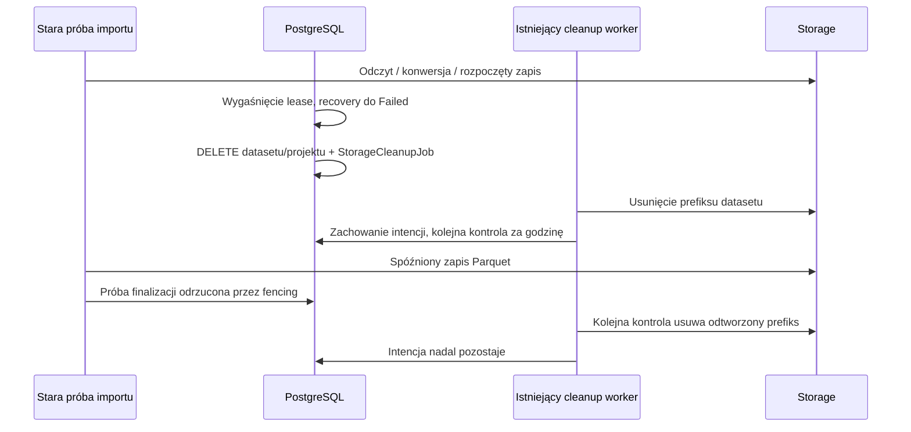

# Aperture — AUD-006, etap 1: lifecycle plików i trwałe intencje usunięcia

Data: 2026-11-15. Zakres: potwierdzenie wyścigów import–DELETE–cleanup i mała naprawa w istniejącym StorageCleanupJob, bez sweepera wszystkich osieroconych plików. Bez commita, migracji, nowych zależności, zmian konfiguracji i publicznego API.

## 1. Potwierdzone problemy

### P1 — spóźniony zapis po zakończonym cleanup

DatasetDeletionStore.cs:59–109 i ProjectDeletionStore.cs:48–96 blokują DELETE przy Pending/Running oraz atomowo zapisują intencję cleanup razem z usunięciem metadanych. To poprawna ochrona aktywnych importów znanych PostgreSQL.

Nie oznacza jednak zakończenia fizycznej pracy poprzedniego procesu. Recovery może po wygaśnięciu lease doprowadzić do Failed. Wtedy DELETE jest dozwolony, chociaż stara próba nadal ma bufor źródła, konwertuje dane albo kończy już rozpoczęty zapis pliku.

DuckDbCsvImporter.cs:218 zapisuje unikalny wynik przez IFileStorage. Fencing w CompleteAsync uniemożliwia starej próbie opublikowanie Ready, ale nie cofa samego zapisu filesystemu. LocalFileStorage.SaveAsync tworzy katalogi przed CreateNew, więc późny zapis może odtworzyć usunięty prefiks.

Poprzedni StorageCleanupProcessor usuwał swój rekord po pierwszym udanym DeleteDirectoryAsync. Powstający później plik pozostawał bez intencji sprzątania.

**Dowód:** sześć przypadków nowego testu rzeczywiście utworzyło natywny Parquet po zatwierdzonym DELETE i fizycznym cleanup. Następnie wykazało brak rekordu cleanup w poprzedniej implementacji. Testy kontrolują zarówno usunięcie datasetu, jak i projektu.

### P2 — utrata potwierdzenia aktualizacji cleanup również gubiła intencję

W starej implementacji fizyczne usunięcie katalogu i skuteczne SQL DELETE rekordu cleanup mogły zakończyć się wyjątkiem po zatwierdzeniu. Późny plik nie miał już trwałego rekordu, niezależnie od tego, czy worker otrzymał potwierdzenie SQL.

**Dowód:** siódmy test wstrzykuje wyjątek SavedChangesAsync po rzeczywistym zapisie do PostgreSQL, następnie odtwarza późny artefakt i sprawdza dalszą możliwość cleanup.

### P3 — niekontrolowana treść ImportJob.ErrorMessage

ImportJobProcessor kopiował exception.Message i skracał go do 2000 jednostek UTF-16. To nie usuwa fragmentów CSV, nazw kolumn ani ścieżek z błędów DuckDB i filesystemu. Przepływ HTTP już maskował ten tekst; problem dotyczył jego trwałego przechowywania. Naprawiono źródło nowych wpisów.

## 2. Wdrożona poprawka

Udany cleanup nie usuwa StorageCleanupJob. Zamiast tego:
- zachowuje ten sam Id, DatasetId i CreatedAtUtc;
- zeruje AttemptCount po udanym sprzątaniu;
- ustawia NextAttemptAtUtc na godzinę później;
- loguje zachowanie intencji oraz termin następnej kontroli.

Dalszą pracę wykonuje dotychczasowy StorageCleanupWorker. Nie skanuje dysku w poszukiwaniu nieznanych plików; ponawia operację wyłącznie dla prefiksów datasetów wskazanych przez zatwierdzone intencje usunięcia. Wykorzystuje istniejące kolumny, unikalny indeks DatasetId oraz indeks NextAttemptAtUtc. Nie dodano tabel, workerów, portów ani osobnego systemu cleanup.

Błąd filesystemu nadal korzysta z dotychczasowego backoff 30 s, 60 s, …, maksymalnie 32 min. Anulowanie i błąd SQL pozostawiają intencję do ponownego podjęcia. Po odzyskaniu bazy ponowienie DeleteDirectoryAsync jest idempotentne również wtedy, gdy poprzednie usunięcie już się udało.

**Intencje nie wygasają automatycznie.** Samo wygaśnięcie lease, terminalny status, wiek rekordu lub chwilowo pusty katalog nie dowodzi zakończenia starego procesu. Usuwanie intencji po arbitralnym TTL odtworzyłoby tę samą lukę.

To gwarancja **ponawialnego, docelowego sprzątania**, nie zakaz chwilowego odtworzenia katalogu. Nie dodano podatnego na TOCTOU sprawdzenia „rekord istnieje” przed zapisem ani długiej transakcji obejmującej konwersję lub kopiowanie pliku. Kolejność blokad AUD-001, claim/lease/heartbeat i atomowa publikacja pozostają bez zmian.

## 3. Mapa lifecycle i własności

| Artefakt | Własność i tworzenie | Kiedy wolno usuwać | Obecne ograniczenie |
| --- | --- | --- | --- |
| Źródłowy CSV przed przyjęciem metadanych | Żądanie importu; wygenerowane DatasetId/VersionId i kanoniczny SourceStorageKey | LocalFileStorage usuwa własny częściowy zapis; handler po AUD-008 usuwa źródło tylko po potwierdzonym braku zatwierdzenia | Crash lub nierozstrzygnięte tworzenie metadanych może pozostawić źródło bez rekordów |
| Źródłowy CSV zatwierdzonego importu | Dataset/wersja/job; bez nadpisywania istniejącego klucza | Cały prefiks po zatwierdzonym usunięciu datasetu/projektu | Po Completed/Failed CSV nadal jest zachowywany; nie ustalano nowej retencji |
| Robocza kopia CSV, roboczy Parquet i spill | Prywatny Directory.CreateTempSubdirectory konkretnej próby, osobne DuckDB/połączenie | Finally tej próby po zwolnieniu zasobów natywnych | Nagłe zabicie procesu lub nieudane Directory.Delete może pozostawić workspace; cleanup datasetu nie obejmuje TEMP |
| Parquet próby w storage przed publikacją | Unikalny losowy klucz w prefiksie datasetu i wersji | Pewne usunięcie całego datasetu; obecnie brak automatycznego per-file cleanup żywego datasetu | Błąd zapisu/commita lub utrata ownership nie stanowi samodzielnej podstawy kasowania |
| Opublikowany Parquet | Każda DatasetVersion w Ready, także historyczna, nie tylko CurrentVersionId | Zatwierdzone usunięcie właściwego datasetu/projektu | Nie dodano retencji ani czyszczenia historii wersji |
| Kopia Parquet dla odczytu analitycznego | Prywatny tymczasowy plik DuckDbParquetExecutor | Finally operacji odczytu | Crash/nieudany cleanup kopii pozostaje do przyszłej inwentaryzacji TEMP |
| StorageCleanupJob | Trwała intencja dla konkretnego usuniętego DatasetId, bez FK do usuniętej encji | Obecnie nie jest automatycznie usuwana | Potrzebny dowód zakończenia możliwych zapisów lub trwałego zamknięcia namespace przed przyszłym wygaszaniem |

Sprawdzono wszystkie produkcyjne użycia SaveAsync, DeleteAsync, DeleteDirectoryAsync oraz bezpośrednich File.Delete/Directory.Delete w Application i Infrastructure. Dla lifecycle nie zmieniono importera, LocalFileStorage, repozytoriów usuwania ani finalizacji.

Istotne zachowane gwarancje:
1. FileMode.CreateNew i unikalne klucze prób nie nadpisują cudzego wyniku. Cleanup błędu SaveAsync dotyczy własnego utworzonego pliku.
2. AUD-008 zachowuje źródło przy niepewnym przyjęciu metadanych i nie powtarza nieidempotentnego tworzenia rekordów.
3. ImportJobProcessor nie usuwa wyniku tylko dlatego, że finalizacja zgłosiła wyjątek lub odczyt nie potwierdził commita.
4. Pending/Running blokują biznesowy DELETE pod dotychczasową blokadą projektu.
5. Usunięcie metadanych i rejestracja StorageCleanupJob nadal zatwierdzają się razem.
6. Sprzątanie prefiksu usuniętego datasetu jest dozwolone także dla wcześniej opublikowanych wersji tego datasetu, ponieważ metadane zostały celowo usunięte. Nie dotyka Ready wersji innego żywego datasetu.
7. Publiczne API nie pozwala ponownie wykorzystać usuniętego DatasetId. Jest to warunek bezpieczeństwa trwałych intencji; ewentualne przyszłe przywracanie encji z tym samym Id musi go uwzględnić.

## 4. Bezpieczne komunikaty błędów

CreateErrorMessage zwraca teraz wyłącznie krótkie stałe:

| Kategoria | Nowy zapis |
| --- | --- |
| FileNotFoundException / DirectoryNotFoundException | Import source is unavailable. |
| DuckDB InvalidInput | CSV format is invalid. |
| DuckDB Conversion | CSV values do not match the detected column types. |
| Defensywny fallback | Import failed. |

Usunięto kopiowanie exception.Message i niepotrzebny MaxErrorMessageLength. Nie zmieniono filtra błędów trwałych: tylko rozpoznane błędy źródła/CSV przechodzą do TryFailAsync. Nieoczekiwane IOException, OOM i inne awarie nadal korzystają z ograniczonego recovery, a anulowanie/utrata ownership nie jest zamieniana w trwały błąd CSV. Istniejący komunikat końca prób recovery również jest stały.

Rozszerzono istniejące testy diagnostyki zamiast tworzyć drugi zestaw. Sprawdzają dokładny zapis ErrorMessage dla rzeczywistego InvalidInput i Conversion DuckDB oraz błędów pliku/katalogu. Nieoczekiwany błąd, anulowanie, utrata ownership i sukces nadal pozostawiają ErrorMessage=null. Asercje sprawdzają również istniejące logi strukturalne bez danych prywatnych. Nie zmieniono bezpiecznego komunikatu HTTP dla Failed.

Historyczne, wcześniej zapisane ErrorMessage nie są modyfikowane. To nie jest przegląd ani przebudowa wszystkich loggerów aplikacji.

## 5. Testy i ich granice

Nowy ImportStorageLifecycleTests obejmuje:
- dwa rodzaje DELETE: dataset i projekt;
- zapis rozpoczęty przed DELETE, dokończony po fizycznym cleanup;
- źródło zbuforowane przed DELETE, następnie rzeczywistą konwersję DuckDB i zapis już po utracie ownership;
- zapis pliku zakończony sukcesem, lecz z utraconym potwierdzeniem;
- wyjątek po rzeczywistym SQL zatwierdzającym termin następnej kontroli cleanup;
- ponowne usunięcie późnego pliku, zachowanie intencji i idempotentne powtórzenie na pustym prefiksie.

Bramki TaskCompletionSource kontrolują kolejność odczytu/zapisu i operacji bazy. Wygaśnięcie lease jest ustawiane jawnie w PostgreSQL, po czym rzeczywisty recovery osiąga limit jednej próby i Failed. Nie używa się Task.Delay/Thread.Sleep do wyścigów. Heartbeat ma w tych testach odstęp dłuższy od testowego deadline, więc nie zmienia kontrolowanego przeplotu.

Test opóźnionej konwersji nie zatrzymuje silnika w konkretnym miejscu jego natywnego kodu. Przechowuje źródło w buforze, zwalnia rzeczywisty uchwyt pliku przed DELETE, a konwersja DuckDB wykonuje się po utracie ownership. Wymusza to późny natywny wynik nieaktualnej próby bez polegania na czasie anulowania DuckDB. Odrębne dotychczasowe testy badają anulowanie i fencing.

Po pierwszym cleanup testy celowo potwierdzają istnienie późnego Parquet z sygnaturą PAR1. Dopiero następnie kontrolują zachowaną intencję i uruchamiają kolejne sprzątanie. Nie maskują wyścigu przez wstępną blokadę zapisu. Termin kolejnej kontroli przyspieszany jest przez testowe SQL, bez oczekiwania godziny.

Wykorzystano istniejące testy ochrony opublikowanego wyniku przy niepewnej finalizacji oraz ochrony innego żywego datasetu przy błędzie cleanup. Pozostały bez zmian i przeszły. Nie powielano tych scenariuszy.

Wyniki:
- przed zmianą produkcji: **7/7 nowych przypadków nie przechodziło**, wykazując brak intencji po cleanup;
- po poprawce: **25/25 testów celowanych** lifecycle/cleanup/diagnostyki/własności;
- świeży build: **0 błędów i ostrzeżeń**;
- cały standardowy zestaw: **22/22 jednostkowe, 449/449 integracyjnych**, 0 niepowodzeń;
- trzy kosztowne benchmarki nadal Explicit/NotExecuted.

Wszystkie bazy testowe są izolowane przez PostgreSQL Testcontainers. Nie uruchamiano migracji na istniejącej bazie ani benchmarków. [Surowe zestawienie testów](aud006-stage1-test-results.json) rozróżnia oczekiwane porażki sprzed poprawki od końcowych sukcesów.

## 6. Warunki gwarancji i koszt rozwiązania

Intencja pozostaje trwała niezależnie od tego, ile razy plik zostanie późno odtworzony. Gdy zapis się zakończy, działający cleanup worker z dostępem do właściwego storage może go usunąć. Interwał jednej godziny jest terminem kolejnego podejścia, nie twardym SLA: dochodzą kolejka, backoff, awarie i przestoje workera. Nie gwarantuje się natychmiastowego zwolnienia miejsca po DELETE.

Zachowanie jednego rekordu na usunięty dataset jest świadomą decyzją bezpieczeństwa tego etapu. Powoduje wzrost tabeli i powtarzane operacje na znanych prefiksach. Worker zachowuje BatchSize=20 i polling co 15 s; teoretycznie daje to najwyżej około 4800 operacji na godzinę przed uwzględnieniem ich kosztu. Przy większej historii usunięć należy zmierzyć obciążenie i rozstrzygnąć bezpieczne wygaszanie/inteligentną częstotliwość. Nie rozwiązano tego arbitralnym TTL.

Gwarancja dotyczy namespace storage, do którego cleanup worker faktycznie ma dostęp. Wiele hostów z niezależnymi lokalnymi dyskami nadal wymaga przypisania cleanup do właściwych lokalizacji lub innego rozwiązania storage. Wspólna tabela PostgreSQL nie daje automatycznie dostępu do plików innego hosta ani gwarancji, że każdy host obsłuży każdą intencję.

## 7. AUD-006B — następne, niewdrożone prace

1. **Inwentaryzacja bez usuwania.** Rozdzielić CSV, wszystkie opublikowane Ready Parquet, nieopublikowane wyniki, workspace i kopie odczytów. Nie uznawać samego braku rekordu w jednym odczycie, wieku ani braku CurrentVersionId za dowód osierocenia.
2. **Własność plików żywego datasetu.** Przed per-file cleanup potrzebny jest dowód, której próbie należy klucz i że nie może już zostać opublikowany. Dzisiejszy losowy klucz nie zawiera AttemptNumber; sam listing katalogu nie daje takiego dowodu. Uwzględnić niepewny commit oraz wszystkie Ready wersje. Następnie rozważyć małe rozszerzenie istniejącego StorageCleanupJob o cel konkretnego pliku, bez drugiej kolejki.
3. **Źródła bez zatwierdzonych metadanych.** AUD-008 słusznie zachowuje je przy nieznanym wyniku. Sweeper musi odróżnić porzucone źródło od nadal możliwego commita i trwającego uploadu. Potrzebny będzie trwały dowód zakończenia przyjęcia, nie reguła „brak Dataset w SELECT”.
4. **Retencja CSV i historii.** Zatwierdzić, czy i kiedy wolno usuwać źródła Completed/Failed oraz stare Ready wersje. Obecny etap nie podejmuje tej decyzji.
5. **Workspace po crashu.** Ustalić lokalizację, własność procesu/hosta i dowód zakończenia pracy. Wygaśnięcie lease lub wiek katalogu nie dowodzi, że stary natywny proces przestał korzystać z plików.
6. **Wygaszanie intencji i skalowanie.** Bezpieczne zakończenie obserwacji wymaga udowodnienia braku przyszłych zapisów, np. zakończenia wszystkich fizycznych prób lub trwałego zamknięcia namespace dla zapisu. Do tego czasu nie usuwać rekordów według TTL. Zmierzyć tabelę/kolejkę i rozstrzygnąć model wielu niezależnych storage.
7. **Historyczne pozostałości.** Intencje skasowane przed wdrożeniem tej poprawki nie odtworzą się samoczynnie. Ich artefakty wymagają przyszłej bezpiecznej inwentaryzacji, nie ogólnego kasowania starych katalogów.
8. **Historia błędów.** Osobno zdecydować o sanitacji wcześniej zapisanych surowych ErrorMessage; nie modyfikować ich bez przeglądu.

Dopiero po spełnieniu tych warunków można zaprojektować okresowy sweeper wszystkich osieroconych plików. W tym etapie go nie wdrożono.

## 8. Zmiany i przegląd

Produkcja:
- src/AnalyticDashboard.Infrastructure/Storage/StorageCleanupJob.cs — planowanie kolejnej kontroli;
- src/AnalyticDashboard.Infrastructure/Storage/StorageCleanupProcessor.cs — zachowanie trwałej intencji;
- src/AnalyticDashboard.Infrastructure/Services/Import/ImportJobProcessor.cs — stałe komunikaty kategorii błędów.

Testy:
- tests/AnalyticDashboard.IntegrationTests/Concurrency/ImportStorageLifecycleTests.cs — nowy;
- tests/AnalyticDashboard.IntegrationTests/Storage/StorageCleanupProcessorTests.cs — aktualizacja testu zmienionej semantyki;
- tests/AnalyticDashboard.IntegrationTests/Import/ImportDiagnosticsTests.cs — rozszerzenie istniejących asercji i trzech przypadków.

Przegląd techniczny objął cały diff, zachowanie intencji po niepewnym SQL, idempotencję, warunki docelowego cleanup, izolację kluczy i niezmienione mechanizmy współbieżności. Przegląd spójności sprawdził nazewnictwo, using, zasoby testów, brak zbędnych abstrakcji i brak using z inicjalizatorem IDisposable. Usunięto nieużywany limit starego surowego komunikatu; nie pozostawiono starej ścieżki kopiowania wyjątku.

[Pełny diff do code review](aud006-stage1.diff) przedstawia wyłącznie zmiany tego etapu względem treści plików odczytanych na jego początku, wraz z nowymi testami, raportem i wynikami. Nie zawiera wcześniejszych zmian AUD-004/AUD-008 ani samego pliku diff. Nie wykonano commita.
